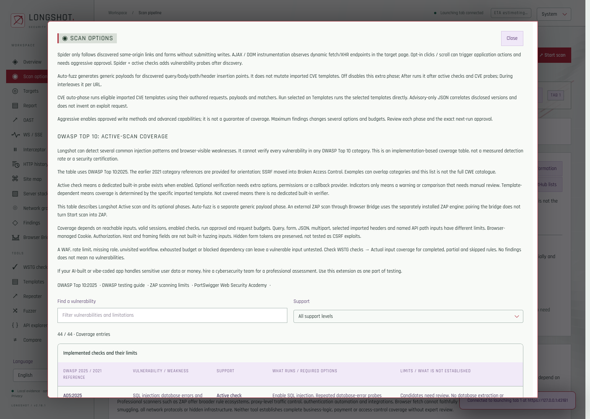
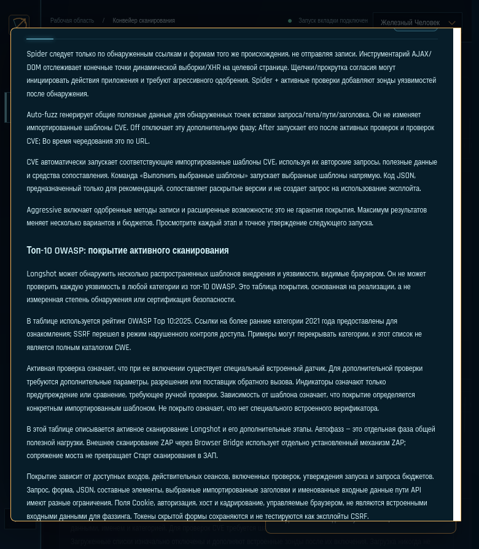
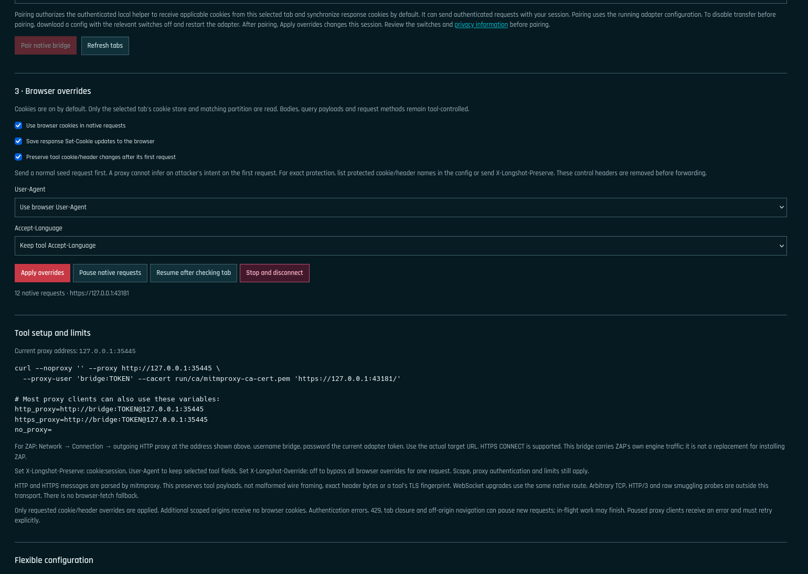

# Longshot 2.18.1 — general tutorial and control reference

Updated 10 November 2026 for Longshot **2.18.1** (Firefox and Chrome editions) and its **native HTTP/HTTPS tool proxy**. This replaces the general 2.11.1 tutorial. Instructions below describe the shipped implementation, including its limits; older bridge examples are not interchangeable with this release.

Longshot is a browser-session workbench for authorized web application assessment. It combines discovery, its own JavaScript active scanner, manual HTTP tools, imported templates, findings review and reports. The optional Browser Bridge lets external tools use selected Firefox session values while sending their own native HTTP requests.

A useful first pass is: **open the application → sign in → launch Longshot from that tab → Connect → validate the session → discover inputs → run selected checks → review evidence**.

For an application handling sensitive user data or money, including an AI-built or vibe-coded application, hire a cybersecurity team for a professional assessment. An extension scan does not replace authorization testing, business-logic review or an independent security assessment. An empty findings list is not a security certificate.

This document explains commands; updating it does not install software, register a host, alter browser settings or run any scans. Run examples only against your authorized assessment target. The sample `http://localhost:8080` is a local target example, not a built-in Longshot service.

## Vibe-coded. Shipped. Hacked.

**Imagine this:** your app goes live, an attacker finds the flaw, and a user opens their account to a balance of zero. All their money—gone.

The code looked convincing. The AI said it looked secure. That was not enough.

**LLMs are nondeterministic. They can miss vulnerabilities and produce confident mistakes. You need a second opinion. You need Longshot.**

Longshot turns Firefox into a security workbench for the web apps you build. Run repeatable checks against the application that is actually running, inspect the HTTP evidence, and investigate the weaknesses before your users pay the price.

Checks cover supported **SQL/NoSQL injection, server-side code and template injection, reflected XSS candidates, path traversal/file inclusion, open redirects and CRLF/header injection**, with optional live DOM XSS verification. Review **weak security headers, cookie and CORS policies, exposed configuration and error disclosures**, with optional checks for further attack classes.

Start from the browser tab you already use. Keep live cookies, configure session validation, recover after session loss, and keep each target’s settings, history and findings organized.

**Put your AI to work—then check its work.** Connect an agent through MCP to run authorized checks and examine findings. Use the native Browser Bridge to bring ZAP, sqlmap, curl, ffuf or wget into the connected browser session without manually copying cookie values. The tools send their own HTTP requests and payloads; browser-cookie overrides are on by default and can be switched off.

Advanced users can import compatible **CVE templates** and correlate **OAST callbacks** with the probes that caused them. Review and record your verdicts, then export evidence-rich **HTML, JSON, CSV or SARIF reports**, with print/PDF output. Explain findings with the **cimematic viewer**, including live CSS/JavaScript page context, animated 3D elements, pause and fullscreen controls. Pick a sharp theme and customize motion and sound to fit your workspace.

**Before you ship confidence, demand evidence. Longshot.**

### Quick scan — one sentence

Open your app in Firefox, sign in if needed, launch Longshot from that tab, click Connect, validate the configured session check, then choose Spider + active checks → Start scan and review Findings.

### Short ad

Your vibe-coded app is live. What did the AI miss? Longshot checks the running app for injection, XSS and other common weaknesses, adds browser-session testing and AI/MCP workflows, and gives you evidence to review. You need a second opinion. You need Longshot.

### Compact description

A second opinion for vibe-coded apps: browser-session checks, AI/MCP, native tools with configurable browser-cookie overrides, CVE/OAST, cinematic findings and reports.

### Campaign captions

1. **VIBE-CODED. SHIPPED. HACKED.** A hypothetical launch-and-account-loss scenario; get a second opinion before shipping.
2. **TEST THE SESSION. CHECK THE APP.** Live cookies, validation and target-specific evidence.
3. **AI WROTE IT. WHO CHECKED IT?** Bring AI suggestions into a reviewable security workflow.
4. **YOUR TOOLS. YOUR TAB. YOUR SESSION.** Browser Bridge for supported local HTTP utilities.
5. **HUNT THE FLAWS. FOLLOW THE EVIDENCE.** Advanced compatible CVE templates and OAST correlation.
6. **PROOF OVER REASSURANCE.** Review and export reports in a workspace you can customize.
7. **YOUR AI IS NOT A SECURITY VERDICT.** MCP checks for your running app; evidence you can review.
8. **EXPIRED SESSION. LOST CONTEXT.** Validate, pause, sign in again and resume.

### Selling points in 2.18.1

| Selling point | Practical benefit |
|---|---|
| **Your signed-in browser session, your tools** | ZAP and other HTTP-proxy clients use the selected Firefox cookie jar by default, with response-cookie synchronization and independent off switches. |
| **The real external scanner engine** | ZAP generates its own native HTTP requests and payloads through Browser Bridge; selected cookie/header overrides are explicit. |
| **Protect the probe, keep the session** | Protected fields and per-request bypass let you preserve a tool's deliberate cookie/header mutations. |
| **Evidence you can inspect** | Dedicated active rules use repeated controls; actual input coverage distinguishes completed, partial and skipped work. |
| **AI that can work through the interface** | MCP exposes supported scan commands and dashboard controls so compatible agents can operate the workbench and retrieve results. |
| **Findings you can explain** | The cimematic viewer combines current page context, recorded evidence, 3D explanations and plain-language potential risks. |
| **Bring your own testing material** | Upload target-specific payload packs and reviewed templates; refresh the supported community lists from the interface. |
| **A workspace that stays yours** | Per-target assessment data, review notes, optional file checkpoints, offline reports, themes and 20 bundled UI languages. |

### Publication notes

The account-loss story is hypothetical, not a claim about a real customer or a guarantee that Longshot prevents financial loss. The extension performs assessments, not continuous attack blocking. Findings require review; the coverage table explains bounded support and manual-only gaps. DOM analysis includes indicators and supported execution canaries, not universal DOM exploit coverage. The cinematic sequence explains evidence; it does not add exploitation proof.

MCP and Browser Bridge need local setup. The native tool proxy uses a separate Node/Python/mitmproxy process, and HTTPS interception requires the tool's trust configuration for the adapter CA. It is parsed HTTP transport, not byte-transparent raw TCP. Cookie overrides can be disabled; a browser cookie or User-Agent does not guarantee browser-identical networking or WAF acceptance. External ZAP remains separately installed. Template execution depends on compatibility/runtimes; OAST requires a configured provider. Authentication validation needs a meaningful protected endpoint/marker. Target profiles separate assessment data; the tab/container supplies the cookie session.

For applications handling sensitive data or money, hire a cybersecurity team and use Longshot as one part of the assessment. Use it only on applications you own or are authorized to test.

If reusing earlier generated campaign images, label them as compositions and use real current screenshots wherever pixel-exact UI is required. This tutorial links the actual 2.18.1 validation screenshots in the appearance section; it does not include a new eight-image campaign pack or claim third-party endorsement.

## Firefox and Chrome: choose your edition

This full guide describes Firefox's supported feature set. Chrome uses the same core browser-session workbench with the platform differences below. References to Firefox containers, live DOM execution, held interception and browser VHOST rewriting later in this guide are Firefox-only.

| Capability | Firefox | Chrome |
|---|---|---|
| Browser active checks, manual/automatic fuzzing, supported HTTP templates, OAST, stack evidence and reports | Supported with the documented prerequisites | Supported with the documented prerequisites |
| Native HTTP proxy with browser cookies/header overrides and response-cookie synchronization | Supported | Supported |
| Page-context AJAX instrumentation and live DOM XSS execution verification | Supported when approved and permitted | Unavailable in this release |
| Separate-container Session B, held interception and browser VHOST rewriting | Supported when configured and permitted | Unavailable in this release |
| Finding viewer | Captured evidence and supported live page context | Captured evidence; live background-page capture unavailable |
| Engine lifecycle | Persistent background page | Keep the visible workbench open; closing it stops new paired native requests |
| Private browsing | Selected contexts, subject to permission and setup | Disabled in this release |

### Install the Chrome edition

1. Download the **Chrome ZIP** from the release links above/below and extract it to a folder you keep.
2. Open `chrome://extensions`, enable **Developer mode**, select **Load unpacked**, then choose the extracted folder containing `manifest.json`.
3. Open your authorized application, sign in, launch Longshot from that tab and Connect.
4. Keep the workbench tab open during scanning and native pairing. Closing it ends live engine work; saved evidence remains and is restored without replaying uncertain requests.
5. For native tool proxy startup, use the exact origin shown by Chrome, such as `chrome-extension://YOUR_INSTALLED_ID`, rather than a Firefox `moz-extension://` origin. The proxy uses real target URLs; no hosts-file entry is needed.

### Chrome Agent API / MCP registration

From the retained full source checkout, after installing the pinned helper dependency:

```sh
npm --prefix native-bridge ci --omit=dev
node bridge/bin/longshot-bridge install --browser chrome \
  --extension-id YOUR_INSTALLED_32_LETTER_ID \
  --port 8775 --data-dir /absolute/private/longshot-chrome
node bridge/bin/longshot-bridge mcp \
  --port 8775 --data-dir /absolute/private/longshot-chrome
```

For Chromium use `--browser chromium`. Use the actual ID in `chrome://extensions`; register again if installing the store edition gives a different ID. The separate port/data directory avoids a collision with a Firefox host. This Agent API is distinct from the HTTP tool proxy (default ports 8900/8901). Linux is the tested native-host platform; macOS registration is implemented but untested here, and no Windows native-host installer is supplied.

Detailed Browser Bridge configuration is also available in the extension's **Browser Bridge → Information** dialog. The long-form README and new platform/privacy documents are English; bundled UI language selection does not translate target evidence, payloads or executable examples.

## Contents

- [Firefox / Chrome editions and setup](#firefox-and-chrome-choose-your-edition)
- [Advertisement and selling points](#vibe-coded-shipped-hacked)

1. [What runs where](#what-runs-where)
2. [Install or update in Firefox Nightly](#install-or-update-in-firefox-nightly)
3. [Getting started and target sessions](#getting-started-and-target-sessions)
4. [Light discovery and a focused active scan](#light-discovery-and-a-focused-active-scan)
5. [Aggressive options and run approval](#aggressive-options-and-run-approval)
6. [Overview checks](#overview-checks)
7. [Scan options reference](#scan-options-reference)
8. [Budgets, selectors and request settings](#budgets-selectors-and-request-settings)
9. [Fuzzer, Auto-fuzz and Probe library](#fuzzer-auto-fuzz-and-probe-library)
10. [Your payloads and imported templates](#your-payloads-and-imported-templates)
11. [Server stack and Smart analyzer](#server-stack-and-smart-analyzer)
12. [OAST setup and interpretation](#oast-setup-and-interpretation)
13. [Browser Bridge: native tool proxy](#browser-bridge-native-tool-proxy)
14. [Native bridge configuration](#native-bridge-configuration)
15. [Cookie and header overrides without damaging probes](#cookie-and-header-overrides-without-damaging-probes)
16. [External tools and actual ZAP scanning](#external-tools-and-actual-zap-scanning)
17. [Tor and onion routing](#tor-and-onion-routing)
18. [Agent API, MCP and local-model clients](#agent-api-mcp-and-local-model-clients)
19. [Optional native Nuclei](#optional-native-nuclei)
20. [Manual tools, interception and API inventory](#manual-tools-interception-and-api-inventory)
21. [Findings and the cimematic viewer](#findings-and-the-cimematic-viewer)
22. [OWASP Top 10 coverage](#owasp-top-10-coverage)
23. [Recovery, assessment files and reports](#recovery-assessment-files-and-reports)
24. [Appearance, language and help](#appearance-language-and-help)
25. [Troubleshooting](#troubleshooting)
26. [Terms and source references](#terms-and-source-references)

## What runs where

The word “bridge” refers to different components. Choose the component needed for your task.

| Component | Runs where | What it does | Default connection |
|---|---|---|---|
| Built-in scanner, Repeater and Fuzzer | Firefox extension and bound target tab | Browser-session HTTP checks using Longshot's JavaScript rules | No external proxy process required |
| **Browser Bridge / Native tool proxy** | Local Node coordinator plus separately installed mitmproxy | Carries external tools' own HTTP/HTTPS requests; optionally overrides cookies and selected headers from Firefox | HTTP proxy `127.0.0.1:8900`; extension control `127.0.0.1:8901` |
| **Agent API / native-messaging bridge** | Local Node service registered with Firefox | REST/MCP/UI automation, assessment files and optional native Nuclei execution | API `http://127.0.0.1:8765` |
| External ZAP, curl, ffuf, sqlmap or Nuclei CLI | Separate processes installed by you | Generate their own traffic and results, optionally through Native tool proxy | Configure each tool's outgoing HTTP proxy |
| Isolated native Nuclei launched by Longshot | Agent API host and Linux sandbox | Runs eligible imported templates with the official Nuclei engine | Separate isolated execution route; no automatic Firefox cookie export |

```text
Built-in scan / Repeater / Fuzzer
        → Firefox networking + target tab's session → target

External ZAP / curl / another HTTP tool
        → authenticated native proxy :8900 → mitmproxy → target
                        ↑
             selected cookie/header values
                        ↑
              paired Firefox tab via :8901

MCP or REST client → Agent API :8765 → Longshot commands / UI
                                      └→ separately enabled native jobs
```

**Start scan does not run ZAP.** Pairing ZAP with Browser Bridge does not replace Longshot's JavaScript scanner or import all ZAP alerts into Longshot. Review an external tool's findings in that tool; the native bridge traffic display is metadata, not a complete vulnerability-results importer.

### Changes that invalidate old instructions

| Older instruction | Use in 2.18.1 |
|---|---|
| Select Legacy browser fetch | Removed from Browser Bridge and the XPI |
| Send tools to `http://bridge.invalid` | Use the actual target URL |
| Add `bridge.invalid` to `/etc/hosts` | No entry is needed; do not add one for this bridge |
| Proxy on `8899`; start `node ./bridge/cli.js` in the old adapter | The downloaded native adapter uses `node cli.js`; default proxy/control ports are `8900` / `8901` |
| `allowRaw`, `forceRaw`, `torSocks`, `X-Bridge-Host`, `/v1/cookies`, pair-check endpoints | Old adapter interfaces; do not put them in the native config or assume they exist |
| Bridge sends byte-exact raw TCP or smuggling traffic | Native proxy parses HTTP; malformed framing and byte-transparent TCP are unsupported |
| Browser session means external tools need no CA | HTTPS interception needs the tool to trust the native adapter's generated CA |
| Tor routing is inherited from Firefox | Native adapter routing is separate; SOCKS is off by default |
| Adapter suspends/restarts external process groups or automatically replays failed work | Pause blocks new proxy requests; inspect and retry/resume the tool explicitly |

## Install or update in Firefox Nightly

Use the **2.18.1 XPI**, not an old adapter ZIP renamed as an add-on. Extract the matching source archive to a folder you keep in place, shown as `/path/to/longshot` in examples. Do not move a registered native host without registering it again.

The release files are:

- [Firefox XPI](https://github.com/zzholdoshev/longshot-security-site/releases/download/v2.18.1/longshot-2.18.1.xpi)
- [Chrome ZIP](https://github.com/zzholdoshev/longshot-security-site/releases/download/v2.18.1/longshot-2.18.1-chrome.zip)
- [Matching extension source ZIP](https://github.com/zzholdoshev/longshot-security-site/releases/download/v2.18.1/longshot-2.18.1-source.zip)
- [Release notes and checksums](https://github.com/zzholdoshev/longshot-security-site/releases/tag/v2.18.1)
- Native adapter ZIP: download it inside Browser Bridge; it is included in each extension package.

These are development/submission builds. Firefox store signing and both marketplaces' approvals are pending. Follow the applicable development-loading procedure rather than expecting the unsigned XPI to install normally in release Firefox.

The manifest requires Firefox 140 or newer. The release integration checks used desktop Firefox 159 on Linux. Platform/runtime support for optional helpers is separate from basic extension support.

For a temporary unsigned installation:

1. Open `about:debugging#/runtime/this-firefox`.
2. Choose **Load Temporary Add-on** and select the XPI.
3. Confirm Longshot's displayed version, then open the target and launch its toolbar button.
4. Reload the extension after replacing an unpacked development build.

A temporary add-on disappears after Firefox restarts. That is expected; it is not the adapter deleting the extension. Persistent public distribution needs Mozilla signing. Nightly has additional unsigned-development options described by [Mozilla's signing guide](https://www.extensionworkshop.com/documentation/publish/signing-and-distribution-overview/); temporary loading does not require changing those settings. See [temporary installation](https://www.extensionworkshop.com/documentation/develop/temporary-installation-in-firefox/).

The XPI bundles the native adapter as a downloadable archive. It cannot start an arbitrary Node/Python process or install the native host solely through Firefox Add-ons. Starting the proxy and registering Agent API are distinct optional local setup steps.

## Getting started and target sessions

### Connect the right tab

1. Open the authorized target in Firefox, for example `http://localhost:8080`.
2. Sign in with the intended test account and complete any browser challenge.
3. Launch Longshot **from that target tab**. Keep the application tab open.
4. Check the target address and choose **Connect**.
5. Use **Getting started** in the header for the eight-step highlighted walkthrough. It can be replayed; it does not start scans or change settings itself.
6. Browse representative application pages so Longshot can observe useful routes and inputs.

A target origin consists of scheme, hostname and port. `http://localhost:8080`, `http://127.0.0.1:8080` and `https://localhost:8080` are different origins, even if they ultimately reach the same service. Connect and use the exact address intended for the assessment. An IP address observed behind a hostname does not automatically become an additional authorized target.

### Configure session validation

Open **Settings → Scanner settings**:

| Field | Meaning |
|---|---|
| Session validation path | An in-scope page/API path that requires authentication |
| Expected authenticated text | A stable marker present when the selected account is signed in and absent after logout |
| Minimum authenticated response bytes | Optional additional lower size threshold; zero disables it |
| Login path | The application's login path, when needed for rejection detection |
| Revalidate after this many requests | Periodic independent session check; default 20 |
| Require successful session validation before scans | Require the configured validator to pass; default off |

Save the settings and use **Overview → Check session**. A public page returning 200 is not proof of authentication. A redirect to a login page followed by 200 can still represent an invalid session; choose a protected endpoint and meaningful marker.

The built-in scanner uses the bound tab's applicable browser cookies, including HttpOnly cookies. Firefox selects cookies by URL, path, security attributes and cookie store. The scanner's protected Cookie/Authorization/Host fields are not ordinary editable fuzz inputs.

### Profiles and accounts

**Targets** separates history, findings, request journal, discovered endpoints, reviews and scan configuration. Returning to a profile restores assessment data, not an old authenticated browser session. Explicit profiles can share an origin.

Two ordinary Firefox tabs normally share cookies. Use independent containers or a separate private cookie store for genuinely different test identities. Switching profiles does not create a second account session. Session B comparison requires the same target origin and a separate store.

## Light discovery and a focused active scan

### First pass: discovery and passive review

1. Set **Requests per second** to 0.5–1, crawl depth to 1 and maximum discovered URLs to 25–50.
2. Leave **Maximum findings**, **Aggressive**, CVE auto-phase, OAST and native execution off.
3. Set **Auto-fuzz → Off**. Leave page clicks/scroll and live DOM/timing/callback tests off.
4. Select the passive Overview groups: headers, cookies, disclosure, forms, DOM source/sink review and CORS.
5. Choose **Spider only** and start.
6. Inspect **Site map**, **HTTP history**, **API explorer**, **Server stack** and **Findings**.

Spider follows discovered in-scope links/forms without submitting form writes. It does not know every hidden endpoint. GET requests can still have application-specific side effects; “read method” does not establish a side-effect-free target.

### Second pass: a bounded active assessment

1. Keep **Auto-fuzz → Off** to make the built-in active rules easier to review separately.
2. Select the relevant Overview active checks, such as SQL injection and Reflected XSS.
3. Use small limits, for example 150 active requests, 10 active URLs and five active parameters.
4. Choose **Active checks only** to reuse the current page and saved inventory, or **Spider + active checks** to discover first.
5. Start, review any required approval, and watch Activity and request counts.
6. Inspect each finding's request, baseline, repeated probe/control evidence, verdict and confidence.
7. Open **WSTG checks → Actual input coverage** to see completed, partial and skipped work.

**Auto-fuzz Off does not turn off active checks.** The SQLi/XSS/SSTI and other dedicated rules generate their own probes. Conversely, ticking an active rule does not supply a missing input or make a Spider-only run execute the generic active phase.

## Aggressive options and run approval

Aggressive enables explicitly approved methods/capabilities; it does not make every check run or guarantee stronger evidence.

1. Discover inputs and validate authentication first.
2. Enable only needed advanced options and write/upload/delete permissions.
3. Save Scan options.
4. Choose **Review / approve next aggressive run**.
5. Review the target, features, method permissions and budgets.
6. Click **Approve this next run**. This user action requests any missing combined Firefox permissions and creates the next-run grant.
7. Start the run with the reviewed configuration.

The grant is single-use, expires after 30 minutes and is invalidated by relevant target/configuration/request-setting changes. A new scan normally needs a new grant. Saving unfinished options is allowed; starting or approving validates required fields.

Firefox requires `permissions.request()` to originate directly from a real user action. Changing a setting is not a reason to grant arbitrary permissions in the background. If permission is denied, review the exact feature, retry from the approval button or disable that feature. Normal OS/browser permission prompts remain outside extension DOM automation.

### Maximum findings is a broad preset

This preset turns on many phases, including advanced verification, OAST and Session B comparison, and expands several budgets. It is not a “find everything” switch. It does not create an OAST account, fill Provider URL/Callback domain, select a valid Session B, install Nuclei or authenticate missing roles.

If approval reports empty OAST fields or missing Session B, configure them or turn those options off. This is separate from whether the target URL is valid.

### Two command-injection controls

**Overview → OS command indicators** enables direct Unix-oriented command-output probes. It is off by default. **Scan options → Command probes** controls the extra blind callback route when OAST is listening. One checkbox does not automatically configure the other path. Review the authorization requirements for the actual run.

## Overview checks

The default enabled list contains the six passive groups and SQLi, NoSQLi, server code injection, reflected XSS, SSTI, traversal, redirect, CRLF and methods. **OS command indicators** and **Duplicate query parameter handling** start off.

| Check | What it does | Interpretation |
|---|---|---|
| Security headers & HTTPS | Reviews CSP, framing policy, nosniff, HSTS and selected mixed-content references | Defense/configuration indicators, not automatic exploit proof |
| Cookie attributes | Reviews Secure, HttpOnly and SameSite without retaining cookie values as findings | Cookie purpose and browser behavior need review |
| Errors & sensitive content | Recognizes selected traces, configuration/source content and directory listings | Limited to observed content and signatures |
| Form & CSRF review | Reviews password transport/GET forms and recognized token fields | Missing visible token does not prove CSRF |
| DOM XSS source/sink review | Finds nearby URL sources and dangerous sinks in inline code | Heuristic; not execution or complete data-flow proof |
| CORS policy review | Reviews observable allow-origin/credential combinations | Does not test arbitrary Origin reflection or attacker-origin reads |
| SQL injection | Repeats new database-error signatures and true/false comparisons against controls | Evidence remains bounded to tested inputs and syntax families |
| NoSQL injection | Repeats MongoDB/BSON error signatures | No general operator-injection or authentication-bypass verifier |
| Server-side code injection | Computed JavaScript/PHP canaries | Small language/context set |
| Reflected XSS | Reflection gate plus repeated inert parsing of executable-looking HTML contexts | Candidate until actual execution is verified |
| Server template injection | Unique arithmetic markers and repeat/control checks | Does not cover every template engine or blind context |
| Traversal / file inclusion | Repeated known file-content signatures | Not exhaustive encodings, files or platforms |
| Open redirects | Generated .invalid Location canary | External redirect destination is not followed |
| Response header injection | Repeated generated header marker | Browser URL/header handling limits the test |
| Advertised HTTP methods | OPTIONS and Allow inventory | Advertisement is not permission to write |
| Duplicate query parameter handling | Repeated first/last-order comparisons | Informational parsing difference, not proven security impact |
| OS command indicators | Optional repeated id-output indicators | Unix-oriented, context-dependent and off by default |

Supported active insertion points include query values, nested JSON/arrays, form/multipart fields, selected editable imported headers and named API path inputs. Bodies must be known and permitted. Managed authentication/framing fields, excluded values and unavailable request bodies are not silently invented.

Hidden form values are preserved and refreshed where supported before form writes; unavailable tokens can make coverage skipped. This mechanism does not establish that a form's CSRF protection works.

## Scan options reference

Unless noted otherwise, these optional phases start off. **Adaptive request rate** defaults on; the default Auto-fuzz mode is Off. Settings restored from an existing profile can differ from fresh defaults.

| Option | What changes / prerequisite |
|---|---|
| CVE auto-phase | Executes eligible imported CVE templates using their authored requests/matchers within CVE/global budgets |
| Aggressive (authorized) | Enables next-run approval for write methods and advanced capabilities |
| Allow multipart file uploads | Separately permits file-bearing multipart requests; does not generate an upload test |
| Allow DELETE (separate consent) | Separately permits DELETE; does not automatically issue a delete request |
| AJAX / DOM instrumentation | Observes dynamic application endpoints and supported page activity during bounded discovery |
| Opt-in page clicks / scroll | Adds bounded interactions; requires AJAX discovery and Aggressive approval; application handlers can change data |
| Live DOM XSS verification (new tabs) | Tests bounded query/fragment-query URL inputs in disposable same-store tabs; two fresh local canaries plus a negative control; CSP remains enforced |
| Repeated timing probes | Repeated SQL delay comparisons and a JSON MongoDB timing candidate, starting with the first insertion point; requires Aggressive |
| SSRF canaries / callbacks | Internal-address response differences plus exact OAST correlation when configured; requires Aggressive |
| XML external entity probes | Callback canary for known XML request bodies; requires approved OAST setup for the implemented test |
| Log4Shell OAST probes | Callback canary in an eligible input and X-Api-Version; an interaction is not proof of code execution |
| Command probes | Blind command callback route when OAST is listening |
| Imported deserialization templates | Includes eligible imported deserialization-tagged templates; no universal gadget generator |
| Adaptive WAF mutations (max 3) | Bounded alternative representations of eligible probes; never a guarantee of bypass |
| Compare with Session B | Compares up to ten eligible read requests with another same-origin cookie store; ownership/roles remain manual context |
| Discovered WebSocket probes | Bounded channel exchanges; no invented application-specific attack protocol |
| Discovered SSE probes | Bounded EventSource listening; not a general stream-authorization verifier |
| Offline client library SCA | Small bundled known-version/range catalog for observed client assets |
| Parameter / header mining | Uses names learned from target/API evidence; not a complete hidden-input dictionary |
| Native full Nuclei execution | Enables official-engine template jobs through Agent API, subject to Linux isolation and consent |
| Sandboxed native code / JavaScript | Additional capability for reviewed/signed native templates |
| Isolated headless browser | Additional native headless capability; isolated from Firefox's login |
| Native allowlisted file reads | Additional read-only local file capability inside the chosen allowlist |
| OAST (external provider) | Registers/polls the specified provider; select relevant vulnerability probes separately |
| Community SQL probe lists | Adds the supported filtered SecLists/FuzzDB values to relevant SQL checks/fuzzers |
| Adaptive request rate | Conservative throttling/challenge handling; does not automatically raise the rate |
| Enabled uploaded payload packs | Adds selected target-specific values; requires Aggressive plus next-run approval |

Live DOM verification is not general taint tracking. Stored XSS, postMessage/local-storage sources, non-URL inputs and multi-step write/read workflows require additional testing. A blocked dependency or timeout is incomplete coverage, not a pass.

## Budgets, selectors and request settings

There are **two separate sets of limits**: Longshot's built-in scan limits and the native tool proxy's limits. A ZAP request through :8900 does not consume the built-in JavaScript scan budget, and Longshot's checkboxes do not choose ZAP's scan policy.

### Operation and phase selectors

| Selector | Choices and behavior |
|---|---|
| Operation | Spider only; Spider + active checks; Active checks only |
| Auto-fuzz | Off; After active and CVE; During scan. This controls an extra phase, not dedicated active rules |
| Attack model | Sniper; Battering ram; Pitchfork; Cluster bomb for supported structured automatic/body mutation planning |
| Session B | Another same-origin tab with a genuinely independent cookie store |
| Body fuzzer method | POST, GET, PUT or PATCH, subject to request policy and approval |
| Body format | JSON, form URL-encoded, multipart or raw/XML; not every format provides generic scalar insertion points |
| Body payload class | SQLi, NoSQLi, code, XSS, SSTI, traversal, CRLF, redirect, command or custom |

Attack models in this implementation:

- **Sniper:** vary one input at a time.
- **Battering ram:** put the same payload into all selected inputs.
- **Pitchfork:** use a staggered/rotating sequence from the shared payload list across inputs. This is not a claim of Burp's independent-list behavior.
- **Cluster bomb:** bounded combinations across inputs; the cap prevents unlimited Cartesian expansion.

### Scan option limits

| Field | Fresh default | Accepted range |
|---|---:|---:|
| Global request budget | 2,000 | 1–10,000 |
| Fuzz requests per parameter | 40 | 1–200 |
| CVE requests per template | 50 | 1–200 |
| CVE requests per target | 500 | 1–2,000 |
| Concurrency limit | 1 | 1–2; does not promise parallel browser throughput |
| AJAX event budget | 20 | 1–100 |
| AJAX page budget (ms) | 5,000 | 500–15,000 |
| AJAX page count | 10 | 1–100 |
| Delay probe (seconds) | 5 | 1–5 |
| OAST Callback TTL seconds | 300 | 5–3,600 |
| OAST Poll seconds | 10 | 5–15 |

### Scanner settings

| Setting | Fresh default / purpose |
|---|---|
| Requests per second | 1; UI supports 0.5–5 |
| Maximum crawl depth | 3; UI supports 0–5 |
| Maximum discovered URLs | 100; UI supports 1–500 |
| Maximum bytes per response | 2 MB; larger/truncated responses can leave evidence gaps |
| Transport retries | 2; not a guarantee a particular write can be safely replayed |
| Maximum fuzz probes per parameter | 40; separate from the extra-phase parameter budget |
| Maximum active requests | 150 |
| Maximum active URLs | 20 |
| Maximum active query parameters | 10; the audit also records other supported insertion-point kinds |
| Excluded path prefixes | One prefix per line; prevents those paths from being generated test targets |
| Excluded parameter names | One name per line |
| Keep redacted scanner response bodies locally | On; supports review/Compare within limits, with best-effort redaction |

Active audit reserves bounded allowances for later enabled rules. More payloads can therefore make some rules partial rather than testing every variant. A configured maximum is a ceiling, not a promise to use every request or finish every input.

### Other selectors

| Page | Selectors and meaning |
|---|---|
| Findings | Severity and review status; negative/blocked visibility changes display only |
| Templates | Severity, ready-only filter and manual selection; Ready is permission/compatibility state, not a vulnerability verdict |
| Repeater | GET/HEAD/OPTIONS/POST/PUT/PATCH/DELETE and raw/XML, JSON or form bodies |
| Fuzzer | Payload family and value mutation: original, URL/double encoding, case change, encoded dots, tab/semicolon suffix, double-slash prefix, trailing dot/space |
| Interceptor | Resource type, method and timeout action; these filter held traffic rather than rewriting its method |
| WebSocket / SSE | Select the observed channel protocol |
| Server stack | Automatic NVD+OSV, NVD product/CPE or OSV package/version; manual npm/PyPI ecosystem |
| Compare | Saved baseline and comparison response |
| Utilities | URL/Base64/hex encoding/decoding, SHA-256, JSON formatting and JWT claim inspection |
| WSTG checks | Category and automated/assisted/manual reference filters |
| Themes/language | Global appearance and bundled language, independent of scan options |

## Fuzzer, Auto-fuzz and Probe library

### Pick the right action

| Action | Who chooses inputs? | Output |
|---|---|---|
| Active scan | Longshot uses discovered supported inputs | Dedicated rule evidence with repeats/controls |
| Run fuzzer | You choose one URL and query parameter | Baseline and selected payload-response comparisons |
| Body fuzzer | You provide a structured request and mutation choices | Bounded body/path/header variations where supported |
| Auto-fuzz button | Saved current-page/site-map/API inventory | Extra generic payload exploration across eligible discovered inputs |
| CVE auto-phase / Run selected | Imported template definitions | Template-specific requests and matcher results |

### Manual query fuzzer

1. Connect the target and choose a scoped URL. Relative URLs such as `/search?q=apple` are accepted against the connected origin.
2. Enter the existing query parameter name, or choose **Use** beside a discovered input.
3. Choose a payload class and value mutation.
4. For **User-uploaded custom payloads**, enable a suitable custom pack first.
5. Choose **Run fuzzer**, then inspect baseline, request, status, length/timing and evidence.

A missing URL, parameter or empty custom set produces a specific validation message. Changing a response alone does not establish an injection flaw. Server throttling can stop the parameter even if it occurs on the baseline.

### Auto-fuzz discovered inputs

Use **Preview discovered inputs** first. It reads saved inventory and reports eligible/skipped requests without sending probes. Auto-fuzz does not need the manual fuzzer's URL/parameter fields. Browse or Spider first if inventory is empty.

Select payload classes and choose the separate **Auto-fuzz** button. **Include discovered request bodies** starts off and requires Aggressive plus next-run approval. Token-bound forms, unsupported methods, unavailable bodies and XML are skipped by this automatic input selector. Existing exclusions, request limits and throttling behavior still apply.

Available class checkboxes are SQLI, NOSQLI, CODE, XSS, SSTI, TRAVERSAL, COMMAND, SSRF, REDIRECT, CRLF and CUSTOM. Fresh defaults enable SQLI, SSTI, TRAVERSAL, REDIRECT and CRLF. The generic loop skips SSRF; use **SSRF canaries / callbacks** for its implemented verification. CUSTOM uses entered/enabled custom values and reports low-confidence response differences unless a dedicated matcher establishes more.

### Why Probe library belongs here

The library supplies **payload values and reviewed templates**; the fuzzer controls select **where and how to send them**. It does not replace the manual URL/parameter. Shared library options also affect Active scan and automatic phases after saving.

**Update GitHub lists** refreshes fixed sources, not arbitrary executable scanners:

| Source | Used subset |
|---|---|
| SecLists quick SQLi | Filtered punctuation/boolean values, capped at 32 supported entries |
| FuzzDB cross-platform SQL detection | Filtered punctuation/boolean values, capped at 32 supported entries |
| ProjectDiscovery Nuclei templates | Two GET-only Jira starter checks: CVE-2020-14179 and CVE-2021-26086 |
| PayloadsAllTheThings techniques | Basis for bounded implemented SQL whitespace/comment/encoding variations; not a downloaded executable bypass script |

Updates use HTTPS, omit cookies and preserve the old snapshot on failure. Source hashes, refresh time and supported counts are shown. The full input file's hash does not mean every value in that file is used. Downloaded SQL lists exclude destructive/data-extraction/delay/code/callback constructs; built-in rules have their own separately implemented canaries.

Stop a scan before updating. Updating does not start probes, grant approval, enable OAST or upload target data/custom packs to GitHub. A downloaded template that changes into an unsupported/raw/code/headless form is rejected rather than silently promoted to a new execution capability.

## Your payloads and imported templates

### Upload literal lists

Under **Scan options or Fuzzer → Probe library → Your payloads and CVE templates**, choose the category, then **Upload custom file**.

Accepted list forms:

- `.txt`: one literal nonempty value per line; spaces and case are preserved.
- `.json`: an array of strings or an object containing `name`, `category` and `payloads`.
- Categories: `custom`, `waf`, `sqli`, `nosqli`, `code`, `xss`, `ssti`, `traversal`, `crlf`, `redirect`, `command`.

```json
{
  "name": "My SQL review probes",
  "category": "sqli",
  "payloads": ["'", "\"", "' AND 1=1 -- "]
}
```

Packs are target-specific and initially **disabled**. Inspect the preview and explicitly enable the intended pack. Enabled uploaded packs require Aggressive and approval; uploading alone runs nothing.

Limits: 256 KB per payload file, 200 strings per pack, 2,000 characters per value, and at most 10 packs / 500 values / 512 KB of pack configuration per target. Duplicate strings within a pack are removed. Existing method, scope, budget and destructive-SQL guards still apply.

Categorized packs supplement built-in class values. WAF packs additionally need smart variations and eligible filtering evidence. A literal custom payload is not an expected-output matcher or executable extension code. Uploading a CVE number alone cannot verify that CVE.

### Import request/matcher templates

Choose the CVE/Nuclei template category before uploading YAML/YML/JSON; the template-file cap is 2 MB. Review it in **Templates**, including executor and concrete Ready/Blocked reason. Imported templates use the shared library; payload packs stay with their target.

- **Run selected** executes the selected templates directly and does not require CVE auto-phase.
- **CVE auto-phase** considers eligible CVE-tagged/identified imports during a configured scan.
- **Auto-fuzz** generates generic values; it does not rewrite authored CVE payloads or matchers.
- Advisory-only JSON correlates product/version evidence. It does not invent a working exploit request.
- Raw, complex, code, headless, file or non-HTTP templates may require the separate official engine and additional grants, or remain blocked.

Import reviewed relative helper bundles with templates that need them. An unavailable native runtime, out-of-scope request, missing approval or unsupported feature is a reason to inspect, not a successful negative test.

## Server stack and Smart analyzer

Use **Detect software** to collect supported scoped observations. Browse representative pages and retain suitable responses when you need body evidence. Then choose **Analyze recorded evidence** for a local passive correlation of up to 200 recent stored responses. The analyzer itself adds no target requests.

The view separates browser components, WAF/CDN/edge, web server/reverse proxy and application/runtime signals. Product-specific headers, cookie names, asset/bootstrap structures and error text can raise confidence. Challenge-page bodies are excluded from application fingerprinting. A generic 403, nginx banner or CDN edge does not establish that a particular WAF rule is enabled.

Possible configuration cards explain their evidence and a suggested verification. They are hypotheses: browser responses cannot precisely establish origin IP, private subnets, backend database settings, TLS termination, firewall rules or proxy trust lists. Multiple upstreams and rewritten banners can hide or misidentify layers.

### WAF recommendations and rate handling

**Apply conservative scan recommendations** explicitly enables community SQL probes, smart variations and adaptive rate and lowers the configured rate to at most 0.5 requests/second. It does not start a scan or grant advanced capabilities.

Eligible probes consider at most three alternative representations within existing budgets. A blocked baseline is skipped. Browser challenges need normal browser resolution; ordinary ACL denial does not justify endless bypass attempts. A block-to-allow change is reachability evidence, not vulnerability proof.

Repeated explicit challenges can halve the in-memory rate and cause a wait of at least ten seconds. HTTP 429 or 503 with Retry-After stops further scheduled probes; longer Retry-After intervals are respected. The rate does not automatically increase again. New runs start with the configured rate.

### CVE lookup

**Search online CVEs** queries NVD/OSV for supported product/package coordinates after permission. The request sends coordinates, not target URLs, cookies or page content. Unknown versions, vendor backports and unverified package presence limit conclusions. Manual npm/PyPI entries do not prove installation.

No matches does not mean no CVEs. A match is an advisory candidate; inspect prerequisites and use **Find verification templates** to locate suitable imported checks. That button filters templates rather than executing them.

## OAST setup and interpretation

[OAST](https://portswigger.net/web-security/ssrf/blind) observes DNS/HTTP interactions caused by a probe when the normal response does not reveal the behavior. Longshot owns its registration/correlation keys; a random pre-generated callback from another client is not interchangeable.

1. Choose an Interactsh-compatible service you control or are permitted to use.
2. Enter **Provider URL**: the provider's complete API base address, usually HTTPS. HTTP is allowed only for loopback providers.
3. Enter the matching **Callback domain** without `http://`, a port or a path.
4. Enter **Provider token** only if that provider requires it.
5. Set TTL and poll interval; enable OAST plus the relevant SSRF/XXE/Log4Shell/command options.
6. Use **Test OAST connection** to check registration/polling.
7. Use **Test OAST callback** to send a separate correlated canary from this browser.
8. Save, review and approve the actual scan. Inspect exact correlation and protocol in OAST interactions.

For example, if using the matching public service at `https://oast.pro`, its callback base is `oast.pro`. This is an example, not an availability guarantee or a requirement to use that provider. A self-hosted provider needs its own properly delegated reachable domain, DNS/listeners and TLS; a laptop HTTP listener alone is not a public callback service. Follow [official Interactsh setup](https://github.com/projectdiscovery/interactsh).

| Observation | What it establishes |
|---|---|
| Connection test passes | Registration and polling worked through the browser's route |
| Browser callback test passes | This browser could trigger and retrieve its own correlated interaction |
| Target probe produces matching interaction | A correlated interaction occurred; attribute the source and assess its meaning |
| No callback | Inconclusive: target egress, provider reachability, expiry, filtering or unsupported context may explain it |

A DNS resolution can come from an intermediary/security service. A callback alone does not prove arbitrary internal access, data theft or code execution. The separate isolated Nuclei engine owns its own native Interactsh registration; those events are not the browser client's registration.

The browser-side OAST client does not require Go, Node or Agent API. Release tests exercised official-server registration, encrypted HTTP callback retrieval and correlation on loopback; they did not establish public-provider availability or your target server's egress. No hosts-file edit is part of normal correctly delegated OAST setup.

## Browser Bridge: native tool proxy

### What it sends

An external tool generates the request, including its attack payload, method, body and query. The native adapter forwards it through mitmproxy, applying only configured cookie/header changes. It does **not** ask Firefox to perform fetch on behalf of ZAP or another tool.

That preserves native HTTP semantics and the tool's payload generation, but not arbitrary original wire bytes: mitmproxy parses/serializes HTTP and establishes its own outbound TLS connection. A browser User-Agent string does not make the native TLS/network fingerprint identical to Firefox.

### Install the downloaded adapter

1. Open **Browser Bridge**. Only **Native tool proxy** is available in 2.18.1.
2. Choose **Download native adapter** and extract it.
3. Enter the extracted `native-bridge` directory. It contains `cli.js`, `bootstrap.py`, `config.json` and the bundled Node `ws` dependency.
4. Install Node.js 20+ and Python 3.12+ if they are not already available.
5. Run the one-time Python setup:

   ```sh
   cd /absolute/path/to/native-bridge
   python3 bootstrap.py
   ```

   This creates a local `.venv` and installs pinned mitmproxy 12.2.3. Installation needs Internet access. Normal startup does not download scanner code or payload lists.

6. Use the command shown by **your** extension page:

   ```sh
   node cli.js --config config.json \
     --extension-origin moz-extension://YOUR-LONGSHOT-UUID
   ```

   Replace the placeholder with the complete current extension origin. It is not the target website, add-on ID or an origin copied from another Firefox profile.

7. Keep the terminal running. After the proxy listener is ready, it prints the proxy address, control port, new pairing/proxy token and CA certificate path.

When developing from the source ZIP rather than using the bundled adapter archive, install its pinned Node dependency first if absent:

```sh
cd /absolute/path/to/longshot-source
npm --prefix native-bridge ci --omit=dev
cd native-bridge
python3 bootstrap.py
```

`--mitmdump /absolute/path/to/mitmdump` or `LONGSHOT_MITMDUMP` selects an existing runtime. `--data-dir /absolute/private/run-directory` selects the CA/audit directory; the default is `run` inside the native adapter. Ctrl+C stops the adapter.

The manual native proxy is separate from Agent API host registration. It does not need `node bridge/bin/longshot-bridge install` merely to proxy curl/ZAP. Linux/Firefox was exercised in release integration tests; do not infer native-messaging installer support on another platform from this manual Node/Python startup path.

### Pair the selected tab

1. Select the authorized **Target tab** in Browser Bridge.
2. Verify its displayed origin and cookie store. Use **Refresh tabs** if necessary.
3. Enter **Control port** `8901`, unless changed in the adapter config.
4. Paste the current **Pairing / proxy token** from the running adapter.
5. Choose **Pair native bridge** and verify ready status.
6. Review cookie/header switches before routing tool traffic.

The field clears the token after successful pairing. A restart produces a new token: pair again and update proxy credentials in every external tool. The proxy port `8900` is for tools; the control port `8901` is for Firefox. Neither uses the Agent API bearer token from port 8765.

### Actual target URLs and bridge.invalid

Use the real address, such as `http://localhost:8080/search?q=apple`, in your tool. If testing HTTPS, use the real `https://...` address. The proxy's own address remains `http://127.0.0.1:8900` because that is the local HTTP proxy listener, including for HTTPS CONNECT.

**No `/etc/hosts` entry is needed.** The old `bridge.invalid` address was an adapter-specific alias for mapping a utility's HTTP URL onto a selected browser-fetch target. The current native proxy supports actual target URLs and HTTPS CONNECT, so that mapping is unnecessary.

`localhost` is not an interchangeable alias for every target: it names the local machine from the relevant process's network environment. It is correct only when the target is actually local at that origin. A different hostname can select a different virtual host, cookie policy or origin even if both names resolve to the same IP.

An existing obsolete hosts entry is irrelevant to the new workflow; do not use it in tool URLs. No hosts-file modification was made while preparing this tutorial.

### HTTPS trust

The adapter generates its own local CA under the selected data directory, normally:

```text
run/ca/mitmproxy-ca-cert.pem       public CA certificate for tool trust
run/ca/mitmproxy-ca.pem            sensitive CA material/private key
```

Configure the **external tool's assessment trust configuration** with the public certificate path printed at startup. Do not share the private key or assume the system/Firefox trust store was changed. The adapter does not install its CA into either trust store.

For curl:

```sh
curl --noproxy '' \
  --proxy http://127.0.0.1:8900 \
  --proxy-user 'bridge:CURRENT_TOKEN' \
  --cacert /absolute/path/to/native-bridge/run/ca/mitmproxy-ca-cert.pem \
  'https://actual-target.example/search?q=apple'
```

Replace `CURRENT_TOKEN` and the target/certificate path. For an HTTP-only local target, `--cacert` is unnecessary. `--noproxy ''` ensures curl does not silently bypass the proxy for a loopback target.

There are two distinct TLS checks:

- The client verifies the certificate presented by the adapter. Configure the client's trust with the adapter CA.
- The adapter verifies the real upstream server. `tls.verifyUpstream` defaults true. Client `--cacert` does not supply a private origin CA to the adapter.

Do not treat disabling verification as the normal fix for certificate errors. For an owned self-signed fixture, `tls.verifyUpstream:false` is an explicit assessment exception in the adapter config, followed by restart; it weakens that separate upstream check. See [mitmproxy certificate behavior](https://docs.mitmproxy.org/stable/concepts/certificates/).

### Traffic fidelity and limits

| Native proxy supports | Does not establish or support |
|---|---|
| Tool-generated methods, query payloads and bodies | Exact original header bytes/order/casing or malformed framing |
| HTTP/1.1, HTTP/2, HTTPS CONNECT | HTTP/3, arbitrary TCP or non-HTTP scanner modes |
| Configured session/header overrides | Full browser fingerprint, JavaScript challenge execution or browser-owned TLS |
| WebSocket upgrades on the native route | A generic application-protocol vulnerability verifier |
| Tool Host-header probes while retaining an authorized HTTPS CONNECT destination | An unrestricted dial target or automatic new target authorization |
| Scoped additional origins without browser session exports | Browser cookies/header credentials automatically shared across origins |

The native route has no browser-fetch fallback. For raw request-smuggling, unusual wire-framing or custom-TLS research, use an appropriate separate transport. Do not label this parsed proxy byte-transparent.

## Native bridge configuration

Download config from Browser Bridge or edit the adapter's `config.json`. Unknown keys, invalid types and out-of-range values are rejected. Old adapter fields are not native config synonyms.

The running adapter config is authoritative on pairing. **Apply overrides** changes supported browser override choices for the current pairing. **Download config** retains the selected configuration for the next start. Editing general JSON fields does not silently reconfigure listener ports, TLS, routing or limits in an already running process: save/download, restart and re-pair.

### Complete shipped defaults

```json
{
  "schemaVersion": 1,
  "proxy": {
    "port": 8900
  },
  "control": {
    "port": 8901,
    "timeoutMs": 10000
  },
  "browser": {
    "required": true,
    "firstPartyDomain": null
  },
  "cookies": {
    "enabled": true,
    "mode": "replace",
    "saveResponses": true,
    "preserveToolChanges": true,
    "protectedNames": [],
    "includeNames": [],
    "excludeNames": []
  },
  "headers": {
    "userAgent": {
      "source": "tool",
      "value": ""
    },
    "acceptLanguage": {
      "source": "tool",
      "value": ""
    },
    "authorization": {
      "source": "tool",
      "value": ""
    },
    "set": {},
    "remove": [],
    "protectedNames": []
  },
  "scope": {
    "origins": [],
    "excludePaths": [],
    "methods": [
      "*"
    ]
  },
  "limits": {
    "rate": 2,
    "concurrency": 4,
    "maxRequests": 10000,
    "maxBodyBytes": 67108864,
    "timeoutSeconds": 60
  },
  "session": {
    "pauseStatuses": [
      401,
      419,
      440
    ],
    "pauseOn429": true
  },
  "tls": {
    "verifyUpstream": true,
    "http2": true
  },
  "upstream": {
    "url": null
  },
  "routing": {
    "socks5": null
  },
  "audit": {
    "enabled": true
  }
}
```

An empty `scope.origins` defaults to the paired target's exact origin. You do not need to enter the target or a start/end timestamp to begin a normal paired assessment. Scope enforcement still exists; it is chosen by pairing rather than an old mandatory assessment form.

### Field reference

| Field | Effect |
|---|---|
| `schemaVersion` | Native config format; current value 1 |
| `proxy.port` | Tool-facing HTTP proxy port, default 8900 |
| `control.port` | Firefox coordinator port, default 8901; must differ from proxy port |
| `control.timeoutMs` | Browser/control reply timeout, default 10,000 ms |
| `browser.required` | Pairing required by default. Standalone operation needs explicit origins and all browser-derived features off |
| `browser.firstPartyDomain` | Explicit first-party isolation domain if the Firefox cookie API requires it; null uses normal behavior |
| `cookies.enabled` | Use selected Firefox cookies in outgoing native requests; default true |
| `cookies.mode` | `replace` by default; optional `merge`, explained below |
| `cookies.saveResponses` | Apply response Set-Cookie updates to the selected Firefox jar; default true, independent of request override |
| `cookies.preserveToolChanges` | Preserve changes relative to the first request per client connection/origin; default true |
| `cookies.protectedNames` | Cookie names whose tool values must remain under tool control |
| `cookies.includeNames` | Only manage these names; empty means all matching browser names |
| `cookies.excludeNames` | Do not manage these browser cookie names |
| `headers.userAgent`, `acceptLanguage`, `authorization` | `source` is `tool`, `browser` or `custom`; custom needs a nonempty single-line `value` |
| `headers.set`, `remove`, `protectedNames` | Explicit extra header changes and protection; reserved/managed fields require their dedicated controls |
| `scope.origins` | Empty uses paired origin; explicitly listed additional exact origins receive no browser-derived session fields |
| `scope.excludePaths` | Excluded path prefixes, including decoded forms |
| `scope.methods` | Allowed methods; default `["*"]` means all native HTTP methods, not Longshot's browser write approval |
| `limits.rate` | Shared native scheduling rate, default 2 requests/second |
| `limits.concurrency` | Native control slots, default 4 |
| `limits.maxRequests` | Native request ceiling, default 10,000; exhaustion pauses work |
| `limits.maxBodyBytes` | Buffering/body ceiling, default 64 MiB |
| `limits.timeoutSeconds` | Completion lease/timeout, default 60 seconds; no rollback of a request already sent |
| `session.pauseStatuses` | Default authentication-status pause list: 401, 419, 440 |
| `session.pauseOn429` | Pause on throttling by default |
| `tls.verifyUpstream`, `http2` | Both true by default |
| `upstream.url` | Optional HTTP(S) upstream proxy; null means none |
| `routing.socks5` | Optional `socks5h://host:port`; null by default; mutually exclusive with upstream URL |
| `audit.enabled` | Metadata-only JSONL audit, default true |

Native validation ranges: ports 1024–65535, rate 0.1–100, concurrency 1–32, request ceiling 1–1,000,000, body limit 1 KB–256 MiB, timeout 1–600 seconds, control timeout 1,000–120,000 ms. These are accepted configuration bounds, not recommendations for a target's safe load.

Header names are case-insensitive. Cookie names are case-sensitive. Use JSON booleans `true`/`false`, not strings. Generic `headers.set` cannot replace Host, Cookie, Authorization, framing or proxy-control fields. Use dedicated cookie/Authorization options and the tool's own Host value.

To lower load for a native tool run, a partial config can override defaults, for example:

```json
{
  "schemaVersion": 1,
  "limits": {
    "rate": 0.5,
    "concurrency": 1,
    "maxRequests": 500
  }
}
```

There is no general native config key that refreshes form body tokens or invents a browser login workflow.

## Cookie and header overrides without damaging probes

### Default cookie behavior

**Use browser cookies** and **Save response Set-Cookie updates** are on by default. User-Agent, Accept-Language and Authorization remain tool-controlled by default.

For a native request, Firefox selects applicable cookies for the URL from the paired tab's cookie store and matching partition. Other containers/private stores are not merged. Domain/path/Secure/expiry rules and same-name path ordering remain relevant. Values are supplied to the native proxy so it can construct the outgoing Cookie header; unlike the removed browser-fetch path, the native helper therefore handles session secrets in memory.

With `cookies.mode:"replace"`, the browser jar is authoritative, including when empty. A browser cookie deleted from the jar is removed from later managed requests. Explicitly protected names and detected tool changes take priority. With `mode:"merge"`, unrelated tool cookies can remain while browser-managed names are updated.

Response Set-Cookie fields are applied individually to the same selected store using Firefox's cookie API, including supported Domain/path/Secure/HttpOnly/SameSite/expiry/deletion/partition attributes. Invalid cookies can be rejected; inspect reported errors. Additional configured origins do not receive browser cookies or browser-derived headers.

### Request and response switches are independent

| Request cookie override | Response synchronization | Result |
|---|---|---|
| On | On | Use Firefox cookies and update the jar from response Set-Cookie |
| Off | On | Keep the tool's request cookies; target responses can still change Firefox's jar |
| On | Off | Use Firefox cookies; do not write response cookies back through this helper |
| Off | Off | Keep request cookies tool-controlled and do not synchronize responses |

For cookie-fuzzing or a session experiment that must leave the browser jar unchanged, consider both switches. A per-request override bypass affects the request-side overrides; it does not disable the independent global response-cookie synchronization setting.

### Protect fields that contain attack payloads

Suppose ZAP tests `session=ATTACK_PAYLOAD`. Blindly replacing that value with the browser's valid session could erase the test. Conversely, retaining a stale cookie in every request could make an authenticated scan useless.

The default **Preserve tool cookie/header changes after its first request** records a baseline per client connection/origin and preserves subsequent changes. Send an ordinary seed request first. The proxy cannot reliably infer intent on the first request, and a new connection creates a new baseline. This heuristic is not complete protection.

For predictable testing, choose one of these mechanisms:

1. Disable the particular cookie/header override being tested.
2. Add cookie names to `cookies.protectedNames` or headers to `headers.protectedNames`.
3. Send a selective per-request annotation:

   ```http
   X-Longshot-Preserve: cookie:session, User-Agent, Authorization
   ```

   This keeps the tool's named cookie/header fields. `cookie` without a name preserves the complete tool Cookie header.

4. Bypass all request-side overrides for that request:

   ```http
   X-Longshot-Override: off
   ```

The adapter strips these annotation headers before forwarding. Proxy authentication, scope and limits still apply. Configure annotations in the originating tool; putting them into a target webpage is not a bridge configuration mechanism.

For example, keeping `session` protected lets ZAP vary it while the helper can continue updating an unrelated `preferences` cookie. For exhaustive Cookie/Authorization/User-Agent testing, disabling those overrides avoids dependence on change-detection heuristics.

### Browser Authorization and other headers

Browser Authorization is opt-in through JSON configuration. It is captured from an actual request by the paired target tab only after enabling browser sourcing. It is not an automatic reader for every token in localStorage or application memory. A later browser request may be needed before an observed value exists. Turning browser Authorization off stops that captured value being supplied by the helper.

Choosing browser User-Agent or Accept-Language changes those HTTP fields only. It does not run target JavaScript, refresh a body CSRF token, reproduce browser TLS or guarantee WAF acceptance. IP/device-bound authentication and OAuth refresh still need their application workflow.

### VHOST / Host handling

The native helper does not substitute an internal bridge alias into the tool's Host field. Let the tool send the Host value needed for the authorized virtual-host test. For HTTPS, the CONNECT destination remains the authorized target while the tool's Host header can be preserved.

Changing a Host header does not grant access to another network destination. A reverse proxy may route it to another application; include that virtual-host behavior in the assessment's authorization. Exact malformed header bytes and conflicting framing are outside this parsed proxy.

### Audit and privacy

**Native traffic** shows request metadata and changed/protected field names. Audit omits cookie/header secret values, query values and bodies. This does not mean the proxy never handles secrets: it must process them to send authenticated traffic. External tools maintain their own histories/results, which can contain those values.

Keep private config tokens, CA keys and data directories out of reports/source archives. Downloading configuration with custom Authorization values can create a file containing those values.

## External tools and actual ZAP scanning

### Start with one request

Pair the bridge, then test the actual local target:

```sh
curl --noproxy '' \
  --proxy http://127.0.0.1:8900 \
  --proxy-user 'bridge:CURRENT_TOKEN' \
  'http://localhost:8080/'
```

Use a known authenticated read path to check session behavior. A 200 from a public home page is not sufficient. Confirm the request appeared in Native traffic, the selected cookie store is correct, and the tool received the expected content. Do not infer all later requests use the proxy merely because this one did.

### ZAP outgoing proxy

1. Install/start ZAP separately and use an assessment-specific ZAP session.
2. In ZAP's **Options → Network → Connection**, enable the **outgoing HTTP proxy**.
3. Set host `127.0.0.1`, port `8900` (or the current configured proxy port).
4. Enable proxy authentication: username `bridge`, password the current adapter token.
5. Disable ZAP's own SOCKS proxy for this chain. ZAP's SOCKS setting takes precedence over its HTTP proxy.
6. Check HTTP proxy exclusions so the intended target is not bypassed, especially for a local service.
7. Configure the adapter CA in the tool's applicable TLS trust/verification setup when required. Its location is printed at adapter startup.
8. Access the **actual target URL** from ZAP and verify its history plus bridge metadata.
9. Define ZAP's own target/context, scan policy, exclusions, authentication checks and modest request rate. Run its actual spider/active scan as authorized.
10. Review findings and coverage in ZAP. When deliberately fuzzing cookie/header authentication fields, use the protection/bypass mechanisms above.

This setting is ZAP's **outgoing connection**, not its local incoming browser proxy listener. Firefox need not be reconfigured to use ZAP merely to supply the selected tab's cookies to this chain.

ZAP generates its real active-rule payloads; mitmproxy sends the resulting native requests. Longshot changes only opted-in request fields. This increases the external tool's usable session context but does not make either tool's scan comprehensive. See [ZAP connection settings](https://www.zaproxy.org/docs/desktop/addons/network/options/connection/).

### Other HTTP tools

| Tool/client | How to connect | Important limit |
|---|---|---|
| curl | `--proxy`, `--proxy-user`; `--cacert` for HTTPS trust; clear proxy bypass where needed | Different invocations/connections can reset heuristic probe baselines |
| ffuf | Its HTTP proxy option (`-x`) with authenticated proxy URL; supply a bounded scoped wordlist and low rate | An HTTP proxy does not constrain a separate non-proxied invocation |
| sqlmap | Its HTTP proxy option with current credentials; select the authorized URL/parameter and protect fields being tested | Separate SQLi engine/settings; cookie replacement can erase cookie probes unless configured |
| wget | Authenticated `http_proxy`/`https_proxy` or its proxy settings; configure certificate trust | Check `no_proxy` and tool-specific proxy behavior |
| Python urllib / Requests | Explicit authenticated proxy handler/config plus adapter CA for HTTPS | Libraries differ in environment-variable and bypass handling |
| Nuclei CLI | Configure its HTTP proxy/trust for supported HTTP template traffic | Non-HTTP/code/headless template traffic is not universally covered by one HTTP proxy option |

A proxy URL containing credentials is sensitive. Use your tool's private assessment configuration where available. Do not paste current tokens into shared reports. For each tool, confirm routed traffic rather than assuming every protocol or subprocess honors its HTTP proxy setting.

Linux Python standard-library example for a read-only local target; it prompts for the token instead of hardcoding it and clears environment proxy bypass for this process:

```python
import os
from getpass import getpass
from urllib.request import (
    HTTPPasswordMgrWithDefaultRealm,
    ProxyBasicAuthHandler, ProxyHandler, build_opener,
)

os.environ["no_proxy"] = ""
os.environ["NO_PROXY"] = ""
proxy = "http://127.0.0.1:8900"
credentials = HTTPPasswordMgrWithDefaultRealm()
credentials.add_password(None, proxy, "bridge", getpass("Bridge token: "))
opener = build_opener(
    ProxyHandler({"http": proxy, "https": proxy}),
    ProxyBasicAuthHandler(credentials),
)
with opener.open("http://localhost:8080/", timeout=20) as response:
    print(response.status)
    print(response.read(200).decode("utf-8", errors="replace"))
```

Verify the request in Native traffic; other platforms can have additional system proxy-bypass rules. The curl example with explicit `--noproxy ''` is the simpler loopback route-validation check. HTTPS Python clients additionally need an SSL context/CA bundle that trusts the adapter certificate.

### Pause and errors

**Pause native requests** blocks new native egress. Authentication statuses 401/419/440, HTTP 429, tab closure/off-origin changes or budget limits can also pause work. **Resume after checking tab** resumes only after reviewing the pairing state.

**Stop and disconnect** ends the browser pairing; it does not terminate the separately started Node process. Use Ctrl+C in its terminal to stop that process.

In-flight requests may finish. Proxy clients receive errors for blocked work; the adapter does not suspend arbitrary tool processes or replay their requests. Inspect which requests succeeded and use the tool's own retry/resume controls. Restarting/re-pairing changes the token and requires updating tool authentication.

401/419/440 may be expected in deliberate negative authentication tests. If needed, adjust `session.pauseStatuses` for that reviewed run and restart; the adapter does not infer whether every authentication failure is an intended probe.

## Tor and onion routing

Browser-based Longshot requests follow the selected browser's networking. The native adapter is a different process and does not inherit Firefox/Tor Browser proxy settings.

SOCKS/Tor is **off by default** in the native config. For an authorized onion assessment, use an explicitly configured existing SOCKS service with remote hostname resolution, for example this override if that really is your local Tor listener:

```json
{
  "routing": {
    "socks5": "socks5h://127.0.0.1:9050"
  }
}
```

This example does not start Tor or establish that port 9050 exists. Select the actual configured service; a Tor Browser instance may use a different listener. Restart the adapter and re-pair. An HTTP(S) `upstream.url` and `routing.socks5` are mutually exclusive.

The native shim resolves hostnames through SOCKS and has no silent direct fallback. Without an explicitly configured upstream/SOCKS route, direct onion destinations are rejected before target DNS. A SOCKS URL can also refer to an authorized SSH tunnel or other SOCKS5 service; it is not intrinsically proof of Tor routing.

Cookie sharing does not make the native route's exit IP or TLS/browser fingerprint identical to Firefox. Challenges or session binding may reject it. Check the route and expected session independently.

**Isolated native Nuclei launched by Agent API is different:** its built-in relay has no Tor/SOCKS route and blocks onion targets before system DNS. Use eligible browser-side checks in the intended browser, or a separately configured external tool through the native proxy. Do not assume the Nuclei checkbox inherits `routing.socks5` from Browser Bridge.

## Agent API, MCP and local-model clients

Use this when an agent/script must operate Longshot, retrieve evidence or save assessment files. It is not the :8900 traffic proxy.

### Register and connect the native host

From the retained **source** directory containing `manifest.json` and `bridge/`:

```sh
cd /absolute/path/to/longshot-source
node bridge/bin/longshot-bridge install
```

This registers `longshot.bridge` and a launcher referencing the source folder and Node executable. Keep both in place. If either moves, register again.

Open **Settings → Connection & setup → Connect native bridge** and grant Firefox's native-messaging permission. The host can start its daemon automatically. If intentionally running the daemon manually:

```sh
node bridge/bin/longshot-bridge serve
```

Avoid a second daemon on the same port/data directory. Disconnect closes the extension's native connection; it does not necessarily stop an independently started daemon.

Node.js 20+ is required. Native messaging MCP does not need the proxy's Python/mitmproxy installation. Linux is the exercised setup. macOS registration support is provided but not runtime-verified here; this release has no Windows Firefox native-host installer. Registering in WSL does not register a host for Windows Firefox. Native Nuclei isolation is Linux-only.

Default service: `http://127.0.0.1:8765`. This localhost address is a control API, **not the scanned target**. The token/socket defaults to `$XDG_DATA_HOME/longshot` or `~/.local/share/longshot`. Custom `--port` and `--data-dir` must match across install, serve and mcp. Use a short Unix data path because its socket path has a 100-byte limit.

### REST example

From that same source folder:

```sh
longshot_token_file="$(node bridge/bin/longshot-bridge token-path)"
longshot_api_token="$(cat "$longshot_token_file")"

curl --fail-with-body \
  -H "Authorization: Bearer $longshot_api_token" \
  http://127.0.0.1:8765/v1/health

curl --fail-with-body \
  -H "Authorization: Bearer $longshot_api_token" \
  http://127.0.0.1:8765/v1/targets
```

The `token-path` command prints a filename, not the token. The API uses bearer authentication, unlike proxy username/password authentication. It rejects non-loopback clients and browser Origin requests and does not expose a general CORS API. Do not publish it through a public reverse proxy.

Start a small scan only after connecting/activating the intended target and checking its saved options:

```sh
curl --fail-with-body \
  -H "Authorization: Bearer $longshot_api_token" \
  -H 'Content-Type: application/json' \
  --data '{"target_id":"PROFILE_ID","mode":"safe","budget":150}' \
  http://127.0.0.1:8765/v1/scans
```

Replace PROFILE_ID with the selected profile ID. `safe` maps to Spider only; it does not reset every saved advanced option or act as a universal override. The start is asynchronous. Read the returned run ID, then monitor `/v1/scans/RUN_ID`, `/eta`, `/findings` or `/report?format=html`. POST `/pause`, `/resume` and `/stop` control a run. Consult authenticated `/openapi.json` for exact schemas.

REST/JSON-RPC support profiles, scans, findings/reports, templates, OAST and session operations. `/rpc` carries JSON-RPC; `/mcp` offers MCP HTTP, with stdio and SSE options. The service's protocol/API version strings may retain older schema versions; use the extension manifest for the installed UI release version.

### MCP client setup

For a client supporting stdio MCP configuration:

```json
{
  "mcpServers": {
    "longshot": {
      "command": "node",
      "args": [
        "/absolute/path/to/longshot-source/bridge/bin/longshot-bridge",
        "mcp"
      ]
    }
  }
}
```

Use an absolute Node executable if the client has a restricted PATH. Add matching `--port` / `--data-dir` arguments when customized. The stdio helper connects to the local authenticated service; it does not itself replace the Firefox connection.

The current MCP tool catalog contains 21 tools: the scan/template/report/OAST tools plus UI and semantic command discovery/control. Discover the actual catalog rather than relying on the old eight-tool tutorial.

| Tool group | Workflow |
|---|---|
| `longshot_list_targets`, scan/state/ETA/findings/report tools | Use explicit profile/run IDs and inspect asynchronous results |
| `longshot_commands`, `longshot_command` | Discover semantic commands and invoke their supported arguments |
| `longshot_ui_pages`, `longshot_ui_open` | Discover/open target-bound extension dashboards |
| `longshot_ui_snapshot` | Read actual labels, current values, dialogs and element refs |
| `longshot_ui_action`, `navigate`, `wait` | Operate existing controls and verify completion |
| `longshot_ui_downloads`, `clipboard`, `screenshot`, `focus`, `close` | Supported extension-page output and UI management; not arbitrary OS access |

Disabled controls, target scope, state and budgets still apply. Stale refs require a fresh snapshot; a dispatched click alone does not prove success. Firefox/OS permission prompts remain separate browser/OS controls.

**Approval boundary:** direct semantic consent commands cannot mint an aggressive run grant. Authenticated full UI automation can operate the bound dashboard's approval dialog, including its approve button. Giving an agent UI control therefore gives it that UI capability; do not describe such access as incapable of clicking approval. Single-use target/configuration/expiry checks still apply.

### Hermes/Ollama or another local-model agent

Longshot does not accept an arbitrary LLM chat stream or select a model. The **agent application** supplies the model connection and tool-call loop. If your agent supports MCP, configure the MCP server above in that agent. The agent sends supported tool calls and receives tool results; it can inspect/navigate/fill the extension through the exposed UI tools as well as invoke scan commands.

Choose the Ollama model and server in Hermes/the agent's own configuration. Use a model/client combination that supports the agent's tool-call format, and ensure the agent is actually allowed to invoke MCP tools. Longshot's config has no `model`, `ollama` or provider API-key setting. Model access, shell access and unrelated filesystem control are capabilities of the agent host, not granted by installing this extension.

Keep the scope, budgets, account and intended actions explicit in the agent task. Validate generated findings against recorded evidence; model text is not a scanner result or permission grant.

### Optional debugging-port control

The source includes BiDi/CDP control helpers and a one-command `bridge/bin/longshot-ui` interface. This is advanced control of extension-owned pages. The Chrome edition is a separate Manifest V3 package; its visible workbench must stay open. Opening a browser debugging listener is a separate browser startup choice; see [Firefox Remote Agent security](https://firefox-source-docs.mozilla.org/remote/Security.html).

The optional debugging helper uses the pinned `ws` dependency in `native-bridge/node_modules/ws/`. Run `npm --prefix native-bridge ci --omit=dev` from the retained source checkout first. This path was corrected in the 2.18 series; the removed historical browser-fetch adapter is not required.

## Optional native Nuclei

There are three distinct template routes:

| Route | Engine/session |
|---|---|
| Browser-compatible imported HTTP template | Longshot's supported template interpreter and target browser session |
| Native full Nuclei checkbox | Official separately installed Nuclei inside the Agent API Linux isolation path; no automatic Firefox login |
| External Nuclei CLI through Browser Bridge | Your independent CLI job; supported proxied HTTP traffic can receive configured browser cookies |

For native jobs launched by Longshot:

1. Install the official Nuclei binary separately and expose it on PATH or set `LONGSHOT_NUCLEI` before starting Agent API.
2. Provide Linux bubblewrap with working unprivileged user/network namespaces.
3. For headless templates, provide the required browser, optionally through `LONGSHOT_CHROME`.
4. Register/connect Agent API and inspect reported native capabilities.
5. Import reviewed templates and any required relative helper files.
6. Enable **Native full Nuclei execution** and only the extra Code/JavaScript, Headless or File capabilities needed.
7. For file templates, set `LONGSHOT_FILE_ROOT` to the explicit read-only allowlist before starting the host.
8. Save, review and approve the run; inspect Ready/Blocked reasons and executor-tagged output.

Workers have an isolated filesystem/network namespace, private temporary storage and bounded execution through the target relay. They do not automatically receive Firefox cookies, browser local storage or Firefox's Tor route. Headless sessions are isolated. A blocked native template does not mean a negative vulnerability result.

Native code/JavaScript templates require signatures trusted by the official engine. `LONGSHOT_NUCLEI_CERT` can point to a reviewed public author certificate; the host does not auto-sign imports or mount private signing keys. Native file templates cannot freely read host home directories. Additional file/code/headless switches remain separate from generic template import.

The native relay supports constrained target/provider connections, not arbitrary network access. Onion targets, unavailable isolation/runtimes, unsupported target addressing or incompatible path scopes can block execution. Native Interactsh registration belongs to Nuclei, separately from Longshot's browser OAST client. Use actual result evidence and platform capability reports, not a “full engine” label, to decide what ran.

## Manual tools, interception and API inventory

### Page guide

| Page | What to use it for |
|---|---|
| Overview | Connect, validate the session, select rule groups, choose the operation and monitor progress |
| Scan options | Extra phases, consent, body fuzzing, provider settings and budgets |
| Targets | Separate profiles, select/attach a browser tab and restore target-specific evidence/options |
| Site map | Discovered URLs/forms/routes; a map of observations, not proof of complete discovery |
| HTTP history | Browser traffic metadata and scanner/Repeater replies; inspect exact inputs and timestamps |
| API explorer | Observed/imported operations and parameter inventory; prepare supported reads in Repeater |
| Server stack | Fingerprints, local Smart analyzer and candidate advisory lookup |
| Network graph | Observed origins/IPs/referenced domains and available vhost evidence; external nodes are inventory, not auto-scope |
| Findings | Evidence, verdict/confidence/severity, review state and cimematic viewer |
| WSTG checks | Reference coverage types and actual per-input audit execution |
| Templates | Import, compatibility/executor details, manual selection and run results |
| Repeater / Fuzzer | Focused request replay or bounded mutation |
| Interceptor | Hold eligible target-tab URL/header stages |
| OAST | Provider/callback status, test actions and correlated interactions |
| WebSocket / SSE | Bounded observed channel exchanges |
| Compare | Local differences between two saved responses |
| Encoder / decoder | Local transformations and token claim inspection |
| Browser Bridge | Pair the native tool proxy and configure session overrides |
| Report | Export the active profile's evidence |
| Settings | Request/session settings, appearance, native connection and assessment files |

### API Explorer

Connect and browse first, then choose **Inspect current page**. Import a developer-supplied **OpenAPI JSON** description when available, up to 2 MB. It reads local JSON, not an arbitrary remote page or YAML file. Local specification references and available request examples/defaults can supply concrete supported inputs; missing values/bodies and unsupported constructs leave gaps.

An endpoint is an address; an operation is an address plus method. Query inputs appear after `?`, path inputs in the address path, and body inputs in submitted content. A listed operation is inventory, not proof that the current account may access every object it addresses.

Use **Repeater** beside a supported GET/HEAD operation to prepare a request without sending it yet. Review URL/method/inputs, then send deliberately. Inventory-only write operations still require you to prepare the appropriate request and obtain write approval.

### Repeater and Compare

Repeater makes a new scoped request using the bound browser session. GET/HEAD/OPTIONS use the ordinary route. Write methods, body changes and destructive/upload capabilities remain subject to policy and approval. Managed Cookie/Authorization/Host values cannot be freely replaced through its header editor; use the native external-tool route for explicitly configured header/cookie tests.

**Follow same-origin redirects** controls whether you inspect the redirect itself or the allowed final response. Off-scope redirects are not blanket authorization. Retain response bodies when needed for review, then choose two saved responses in **Compare**. Compare sends no requests; dynamic content, login state, throttling or WAF pages can explain a difference.

### Interceptor

Enable the interceptor and **Apply interception**. Grant the optional Firefox blocking permission through its normal user action. Interception starts disabled after extension restart.

| Stage / control | Behavior |
|---|---|
| Hold request URLs | Pause before request headers; edit the scoped URL/query or drop |
| Hold request headers | Inspect/edit permitted request headers before transmission |
| Hold response headers | Pause delivery after the request reached the server; cannot undo a server-side action |
| Resource/method/path filters | Restrict eligible traffic in the bound tab and exact target scope |
| Hold timeout | Default 0: no automatic release. Optional 10–3,600 seconds, then selected forward/drop action |
| Forward stage | Resolve this stage; another enabled stage can hold the same request later |
| Drop request | Cancel this stage/request delivery |
| Forward/drop all pending | Resolve the current queue without changing future filters |
| Turn off and forward pending | Disarm interception and release waiting stages unchanged |

The application/browser can time out before you release a long-held request. Up to 20 stages can wait; exceeding the queue limit cancels further matching traffic. Changing filters releases current stages unchanged. Closing the last controlling dashboard releases held stages and disables interception.

Permitted headers use a JSON array of name/value pairs; sensitive/browser-managed/framing fields are protected. Method/body/status rewriting of the held network request is unavailable. **Send to Repeater** creates a separate request shape for deliberate editing; it is not transparent in-flight body rewriting.

Only selected target-tab HTTP traffic is eligible. Scanner transport bypasses interception to avoid deadlock. External native proxy traffic is outside this browser interceptor. WebSocket messages after upgrade need their separate channel workbench.

### WebSocket, SSE and utilities

Choose a discovered in-scope channel or enter its exact URL. Listening and custom frame sends are bounded approved operations, not a general protocol scanner. Captured error text is a lead; it does not establish message authorization or a race/logic flaw.

Utilities encode/decode values, calculate SHA-256, format JSON and inspect JWT claims locally. Decoding a JWT is not signature verification and does not establish that the server accepts a forged token. Transformed input is not automatically executed or submitted.

## Findings and the cimematic viewer

### Read the evidence first

A finding has separate fields:

| Field | Meaning |
|---|---|
| Severity | Estimated potential harm if the issue is exploitable |
| Verdict | What the scanner observed: potential/matched/vulnerable, negative, blocked or inconclusive, as applicable |
| Confidence | Strength of the implemented evidence, not the amount of harm |
| Review status | Your assessment: Unreviewed, Confirmed by reviewer, False positive or Accepted risk |
| WSTG / CWE | Reference classification, not proof that the full test/category was completed |

Inspect the URL, insertion point, request, baseline, payload, response and repeats/controls. Check whether content was truncated or the response was a challenge/login/error page. A high-confidence repeated error can still be a potential injection finding requiring review.

Set review status and notes, then **Save review**. This does not overwrite the scanner's original verdict/confidence. False positives remain retained evidence. Filters, including **Show negative / blocked**, change visibility, not the execution record.

### cimematic viewer

The button is deliberately named **cimematic viewer** in this release. It opens the themed 3D explanation for the selected finding.

The sequence is approximately 9.3 seconds: locate the affected area, show the input, illustrate processing, show recorded result evidence, then display severity and a plain-language potential-risk explanation. Available controls include **Pause/resume**, replay, numbered steps, skip to impact, **3D depth** and **Fullscreen**. Reduced-motion settings can go directly to impact.

| Mode | What it shows |
|---|---|
| Live / CSS + JS | A normal Firefox preview tab loads the current page with its CSS/JavaScript and selected cookie context; the viewer receives rendered frames and element rectangles |
| Captured only | Retained evidence with sanitized, nonexecuting HTML or a capture; no external resources or scripts are run by that offline fallback |
| Recorded result | The saved scan evidence/result plane, which may differ from the current live page |

It is a cinematic viewport, not an interactive cloned site DOM. **Open live tab** opens the real page for interaction. Normal live loading can make the site's ordinary resource/application requests, but opening the viewer does not submit the saved attack form, replay a POST or rerun the exploit.

The camera position is exact only when a matching input/name/id can be located. API/header/cookie findings can have no HTML form; a page-context view is labeled as such. The animation never upgrades a potential finding into exploitation proof. If live rendering fails, use captured evidence and the text/request details.

The viewer's owned preview tab is closed on normal viewer/dashboard cleanup; an explicitly opened interactive tab remains yours to close. Current login, site state, dependency loading and CSP can change what live mode displays.

## OWASP Top 10 coverage

Open **Scan options → Information** for the searchable/filterable 44-entry implementation table, also reachable through the page Information button. It uses [OWASP Top 10:2025](https://top10.owasp.org/2025/) with older 2021 references for orientation. SSRF is now grouped under Broken Access Control. Examples can overlap categories; the list is not the complete CWE catalogue.

Support labels:

- **Active check:** a dedicated implemented rule exists when enabled, for supported reached inputs.
- **Optional verification:** additional options, permissions, provider or execution prerequisites apply.
- **Indicators only:** a passive signal/comparison requiring manual interpretation.
- **Template-dependent:** the imported template and executor determine the tested condition.
- **Not covered:** no dedicated built-in verifier for that class; generic custom payloads do not establish coverage automatically.

This is a source-based capability audit, **not a measured detection percentage**. It describes Longshot's built-in scanner and its optional phases, not the entire external ZAP rule set.

| OWASP 2025 | Vulnerability / weakness | Support | What runs / required options | Limits |
|---|---|---|---|---|
| A05 | SQL injection: database errors and boolean differences | Active check | Enable SQL injection. Repeated database-error probes and true/false comparisons use fresh controls on discovered inputs. | Candidates need review. No database extraction or comprehensive DBMS-specific blind coverage. |
| A05 | Blind SQL injection: timing | Optional verification | Enable Repeated timing probes with Aggressive approval. Three clean timings are compared with three SLEEP probes on the first insertion point. | A narrow SQL syntax and timing heuristic; jitter, WAFs and different database dialects can hide or imitate the result. |
| A05 | NoSQL injection | Active check | Enable NoSQL injection for repeated MongoDB/BSON error signatures. Optional timing verification also tries a MongoDB $where delay on JSON bodies. | No general operator-based authentication bypass, blind NoSQL extraction or coverage of every NoSQL engine. |
| A05 | Reflected cross-site scripting (XSS) | Active check | Enable Reflected XSS. A unique reflection marker and repeated inert HTML-context probes identify executable-looking markup. | HTML-context evidence is a candidate. It does not establish script execution or bypass Content Security Policy. |
| A05 | DOM XSS from URL query or fragment inputs | Optional verification | Enable Live DOM XSS verification and approve Aggressive permissions. Two fresh canaries must execute in disposable same-cookie-store tabs; a control must stay negative. | Bounded URL inputs only. CSP and dependencies remain enforced; timeouts and blocked resources leave gaps. |
| A05 | DOM XSS from postMessage, storage or arbitrary data flows | Not covered | Passive source/sink hints may identify nearby inline JavaScript patterns for review. | No general taint tracking, arbitrary message generation or storage-source execution test. |
| A05 | Stored XSS and multi-step second-order injection | Not covered | A visited page may contain suspicious code or a reflected candidate. | No general write-store-read correlation, workflow replay or stored-payload execution verification. |
| A05 | Server-side template injection (SSTI) | Active check | Enable Server template injection. Random arithmetic results with unique markers must repeat against controls. | Only supported expression families; blind template execution and every template engine are not covered. |
| A05 | Server-side code injection | Active check | Enable Server-side code injection. Computed JavaScript/PHP canaries distinguish evaluation from plain reflection. | A small language/context set; not a universal remote-code-execution test. |
| A05 | OS command injection | Optional verification | Enable OS command indicators for repeated id-output probes. Optional Command probes with a listening OAST provider can correlate a DNS callback. | Requires a compatible command context and, for callbacks, target egress. No callback does not establish safety. |
| A05 | CRLF / response-header injection | Active check | Enable Response header injection. A generated response-header marker must repeat and be absent from controls. | Browser URL/header handling limits payloads. Raw response splitting, cache poisoning and framing attacks are not established. |
| A05 | LDAP, XPath and other unimplemented injection languages | Not covered | Custom payloads, Auto-fuzz or a reviewed template can assist a separate investigation. | No dedicated built-in language-specific verifier; a response difference is not confirmation. |
| A01 | Path traversal / local file inclusion | Active check | Enable Traversal / file inclusion. Supported file-content signatures must repeat on discovered insertion points. | Does not cover every encoding, operating system, remote inclusion or arbitrary file. No directory brute-force inventory. |
| A01 | Server-side request forgery (SSRF) | Optional verification | Enable SSRF and OAST with an approved reachable provider. Exact probe correlation records a DNS/HTTP interaction. | Internal-address response differences are only hints. A callback establishes an interaction, not internal access or data theft; intermediaries may resolve payloads. |
| A01 | IDOR / broken object or function authorization | Indicators only | Enable Compare with Session B using a distinct Firefox container/private cookie store. Up to ten read requests compare status and body hashes. | No object-ownership or expected-role model; identical public pages can be legitimate. No general privilege-escalation proof. |
| A01 | Cross-site request forgery (CSRF) | Indicators only | Form review reports POST forms without recognized token fields and checks visible cookie attributes. | No cross-site exploit submission or server token-validation test. SameSite, custom headers and workflow controls need manual review. |
| A01 | Cross-origin resource sharing (CORS) exploitation | Indicators only | CORS review inspects observed allow-origin and credentials headers. | No arbitrary Origin reflection test or attacker-origin data-read verification. Wildcard with credentials is rejected by browsers. |
| A01 | Open redirect | Active check | Enable Open redirects. A generated .invalid destination in the Location header must repeat. External destinations are not followed. | JavaScript redirects, multi-step login redirects and every URL normalization bypass are not covered. |
| A01 | Tenant isolation, role escalation and workflow authorization | Not covered | Session comparison and imported requests can provide evidence for an analyst. | No understanding of tenant ownership, roles, state transitions or permitted business actions. |
| A02 | Missing security headers, weak CSP and clickjacking defenses | Indicators only | Passive header review during the scan checks CSP, unsafe-eval, framing policy and nosniff on observed responses. | Missing defenses are hardening signals; exploitability, policy completeness and UI-redress impact are not established. |
| A02 | Directory listings, source/configuration exposure and debug traces | Indicators only | Passive review recognizes listing markup, PHP source, configuration-key assignments and selected stack traces in returned content. | Only observed content and signatures; no comprehensive backup-file, secret or hidden-admin discovery. |
| A02 | XML external entity injection (XXE) | Optional verification | Enable XXE and a listening OAST provider with Aggressive approval. An XML request body is replaced with an external-entity callback canary. | Requires an inventoried XML request. No comprehensive parser, SOAP, file-read, parameter-entity or blind extraction coverage. |
| A02 | Dangerous HTTP methods | Indicators only | Enable Advertised HTTP methods. OPTIONS records the Allow response header. | Does not attempt unauthorized PUT/DELETE writes or prove advertised methods are exploitable. |
| A02 | Duplicate query parameter handling | Indicators only | Enable Duplicate query parameter handling for repeated first/last-order response comparisons. | A parsing difference does not prove WAF bypass, access-control failure or proxy/backend disagreement. |
| A02 | Cloud permissions, hidden admin services and backend configuration | Not covered | Stack fingerprints and topology views provide browser-visible hypotheses. | No cloud account access, infrastructure audit, server configuration inspection or exhaustive internal network discovery. |
| A03 | Known vulnerable browser JavaScript dependencies | Optional verification | Enable client-library SCA to compare observed asset versions with the small bundled advisory database. | Version/signature correlation only; backports, reachable vulnerable code, full dependency trees and unseen assets are not verified. |
| A03 | Server dependency CVEs and product vulnerabilities | Template-dependent | CVE auto-phase requires eligible imported templates; only their authored requests and matchers run. Native Nuclei requires its separate engine and approval. | Fingerprint/advisory matches alone are candidates. Two bundled community starters do not provide universal CVE coverage. |
| A03 | Compromised packages, CI/CD and malicious supply-chain updates | Not covered | Dependency names or versions can assist a separate code and build review. | No SBOM completeness, repository/build audit, package authenticity or signing-chain verification. |
| A04 | HTTP password forms, HSTS and insecure resource references | Indicators only | Passive checks recognize password forms using HTTP/GET, absent HSTS and selected HTTP resources referenced by HTTPS markup. | Not comprehensive sensitive-data discovery; does not prove data exposure at rest or assess all transport behavior. |
| A04 | Weak TLS protocols/ciphers, key management and encryption at rest | Not covered | The browser supplies its normal TLS connection. | No cipher/protocol enumeration, certificate inventory, cryptographic design review, password-hash audit or server-side key access. |
| A06 | Business logic, payment/price manipulation and workflow abuse | Not covered | Observed requests and Repeater assist manual testing. | No model of correct prices, account balances, business rules, transaction order or intended application behavior. |
| A06 | Race conditions and resource-exhaustion design flaws | Not covered | Request limits and rate controls bound scanning; rate-limit responses are operational signals. | No synchronized race harness or deliberate denial-of-service verification. |
| A07 | Weak cookie/session attributes | Indicators only | Cookie review reports missing Secure, HttpOnly or explicit SameSite and SameSite=None without Secure. | Cookie purpose and browser defaults matter. Does not establish session hijacking, fixation, logout invalidation or token entropy. |
| A07 | Login bypass, MFA, password reset, brute force and account takeover | Not covered | An injection check may expose one cause of a login flaw. The session validator checks whether the configured login still appears valid. | No general credential attack, MFA/reset workflow testing, lockout audit or account-takeover verification. |
| A07 | JWT, OAuth, OIDC and SAML verification flaws | Not covered | Utilities can decode a JWT locally for manual inspection. | Decoding is not signature verification. No general algorithm-confusion, token-forgery, redirect-flow or federation test. |
| A08 | Log4Shell callback path | Optional verification | Enable Log4Shell and OAST with approval. A JNDI callback canary is placed in the first available input and X-Api-Version. | A matching interaction needs attribution and review; it does not prove code execution. Limited insertion points and target egress can miss vulnerable paths. |
| A08 | Unsafe deserialization | Template-dependent | The deserialization option selects eligible imported templates tagged for deserialization. Review their executor and prerequisites. | No general object-format discovery, gadget-chain generator or universal deserialization verifier. |
| A08 | Unsigned updates, forged application data and integrity controls | Not covered | Captured responses and decoded data may assist manual analysis. | No application trust model, update-signature validation, data-signature audit or general mass-assignment verification. |
| A09 | Missing security logs, alerting, log integrity and incident detection | Not covered | Longshot records its own scan evidence and local request journal. | Scanner logs do not reveal whether the application logs or alerts correctly; inspect server/SIEM evidence and run monitored scenarios. |
| A10 | Information leakage from exceptional responses | Indicators only | Passive error disclosure and active injection controls can notice selected stack traces and newly introduced database errors. | Only returned evidence. A generic error or HTTP 500 alone is not a verified vulnerability. |
| A10 | Fail-open behavior, rollback failures and unsafe exception recovery | Not covered | Status/body differences can guide manual investigation. | No general fault injection, transaction rollback assertions, crash recovery or exception-path access-control model. |
| Other | HTTP request smuggling, malformed framing, cache poisoning and Host attacks | Not covered | The built-in scanner uses browser networking and protects managed headers. | External tools through the native proxy are separate. Its parsed HTTP transport is also not a byte-transparent smuggling or custom-TLS engine. |
| Other | WebSocket / SSE application vulnerabilities | Indicators only | Optional bounded channel tests capture exchanges and report selected error text. | No protocol-aware authorization, message-schema fuzzing, cross-site WebSocket hijacking or business-logic verifier. |
| Other | File upload, GraphQL/SOAP logic and unsupported binary protocols | Not covered | Discovered HTTP requests can expose supported scalar inputs for generic checks. | No dedicated upload execution, GraphQL authorization/complexity, comprehensive SOAP or binary-protocol scanner. |

### Interpreting actual run coverage

The complete WSTG reference map includes automated subsets, assisted work and manual assessment. In **Actual input coverage**:

- **Completed** means the implemented rule finished on that input, not that the input is secure.
- **Partial** means some work ran but a limit, interruption or other condition prevented completion.
- **Skipped** means the rule/input did not run; inspect the reason.

A WAF, missing role, invalid session, hidden/unvisited workflow, unavailable request body, CSP or exhausted budget can leave a vulnerable input untested. Native proxy pairing does not remove those limits from the built-in scanner. An observed CVE version, missing header or different response is not automatically an exploit.

Release 2.18.1 passed 192 automated unit/regression tests, eight real Chrome checks and eight real Firefox checks, including ZIP/YAML CSP verification and native ZAP traffic against an owned SQLite fixture. Its official browser libraries are verified byte-for-byte and a clean source rebuild reproduces the Firefox XPI exactly. Those tests validate named implementation behavior; they do not show detection of every Juice Shop, WebGoat, bWAPP or NodeGoat challenge. The external ZAP SQLi result verifies the proxy path, not Longshot's recall across all vulnerabilities.

## Recovery, assessment files and reports

### Keep recovery paths separate

| Path | What to do after a failure |
|---|---|
| Built-in scan/session | Review the dashboard recovery dialog, sign in again in the original cookie context, validate and continue when allowed |
| Native tool proxy | Check the adapter, tab/store, token and pause reason; explicitly resume/re-pair, then use the external tool's own retry/resume |
| Agent API | Restore the native messaging/daemon connection; then inspect the existing run state before issuing another start |
| Browser restart / imported assessment | Restore saved evidence and revalidate login; do not assume an in-flight network operation or full live scan queue survived |

Independent authentication validation prevents every deliberately rejected login mutation from being mistaken for session expiry. Configure a meaningful protected validator. The live queue may support recovery while the extension is running, but a saved session file does not reconstruct an uncertain write or automatically replay a whole interrupted scan.

### Browser storage and optional session files

Browser storage remains active independently of either local bridge. It keeps per-profile history, findings, reviews, inventory and options. Response bodies can be retained with best-effort redaction; browser-observed traffic often has metadata without a captured body.

For automatic file checkpoints:

1. Register/connect **Agent API**, not just Browser Bridge.
2. Open **Settings → Assessment sessions → Instruction**.
3. Enter an absolute **Session folder** on the Agent API computer.
4. Enable **Automatically save session files** and choose **Save session settings**.
5. Use **Save session now** for an immediate checkpoint; normal changes also trigger saves.
6. Use **Export current session** / **Import session file** for manual transfer; manual import does not require the native host.

Files use stable profile IDs with `.longshot.json`, allowing explicit profiles for one origin. They are readable, unencrypted assessment archives and can contain application data, authored templates and retained bodies. Browser-managed cookies, provider tokens and execution grants are excluded.

Writes are atomic private-file checkpoints. Abrupt termination can recover only the last completed save. Restored running scans become interrupted. If the bridge disconnects, browser storage continues and file saves wait; unresolved enabled checkpoints can require reconnecting or disabling file saving before switching targets. Maximum session-file size is 256 MB with an explicit error.

Assessment archive export is different from **Download config** in Browser Bridge. The former saves assessment evidence/options; the latter saves native proxy settings.

### Reports

Review the active profile before exporting; historical scan reports are also available through the Agent API. Theme-aligned reports contain charts and evidence, but chart counts are alert counts, not a count of unique verified exploitable flaws.

| Format | Use / limit |
|---|---|
| HTML | Self-contained offline report with inline charts, search/filters, evidence details, theme and print controls |
| JSON | Structured redacted evidence, scan configuration and recorded input coverage |
| CSV | Tabular exchange; nested fields serialized and spreadsheet formula prefixes guarded |
| SARIF 2.1.0 | Tooling integration with severity/confidence/verdict/reference and review metadata |
| Print / PDF | Open the HTML report and use Firefox print / Save to PDF; the API's PDF option can return HTML plus print instructions rather than ready PDF bytes |

Review status and notes are separate from scanner verdict. False-positive/accepted-risk reviews remain auditable; SARIF includes review information and suppressions where applicable. Best-effort redaction is not a guarantee that a retained page/body contains no application data. Review the actual export before sharing.

External ZAP/sqlmap/ffuf reports remain separate. Native traffic metadata is not a copy of their complete request/response history or findings.

## Appearance, language and help

Themes are global and can change during a scan without changing the scan grant. The menu includes System, Dark, Light, Cybersteppe, Mr. Robot, Iron Man and saved custom themes. The adaptive layout narrows controls; the coverage table has its own horizontal scroll region for detailed columns.

Under **Settings → Themes & alert sound**:

- Choose the active theme and alert sound/volume; **Test alert sound** previews the selected alert.
- Edit a built-in and **Save as new theme** / duplicate to create a custom theme.
- Select bundled/system UI/code fonts, palette, opacity, background and sound.
- Export/import theme JSON; importing does not execute arbitrary CSS or scripts.
- **Animations & sounds** controls motion and interface audio per theme. Browser/system reduced-motion and mute settings still matter.

Dark/Light, Cybersteppe, Mr. Robot and Iron Man have different visual/audio treatments. Dropdown opening/selection is silent. Servo selection cues are Iron-Man-specific; security failure alerts are separate from ordinary interface sounds.

The language menu offers 20 bundled languages: English, Russian, German, French, Simplified Chinese, Japanese, Spanish, Hindi, Portuguese, Arabic, Bengali, Urdu, Indonesian, Turkish, Korean, Italian, Vietnamese, Tamil, Telugu and Marathi. New coverage/native UI text is included in the supplemental catalogs. These are bundled machine translations of public UI prose, not a runtime translation service. Captured target pages, payloads, URLs, field/code names and command examples keep their original text.

Use **Information/Instruction**, control hints and **How to use this page · terms explained** for context. Terms link to reference material. An information filter/search changes the displayed explanation only; it does not enable checks. **Getting started** is exactly eight slides and can be replayed after dismissal.

Current release screenshots use an owned temporary loopback SQLite fixture. Their random ports and sample account data are test artifacts, not required configuration for your application:

> **Coverage dialog**
> 
> **Narrow Iron Man layout with Russian coverage text**
> 
> **Native proxy page**
> 

## Troubleshooting

| Symptom | Exact area to check / next action |
|---|---|
| Extension is gone after restart | A temporary `about:debugging` installation ends at restart. Reload the XPI or use the appropriate signed/persistent development installation |
| Wrong UI/version after update | Check the manifest/displayed version; reload the intended XPI and close obsolete dashboards. Source directory names can retain old versions |
| `Cannot find package 'ws'` | Verify the path in the error. A complete downloaded native adapter includes ws; a fresh native source directory needs `npm --prefix native-bridge ci --omit=dev`. An error under the old adapter path is an old setup, not the new `cli.js` command |
| `Cannot find module .../bridge/bin/longshot-bridge` | Run Agent API commands from the source root containing `bridge/`, or use the absolute script path. The native proxy ZIP is not the full Agent API source |
| Adapter does not start / mitmdump missing | Run `python3 bootstrap.py` with Python 3.12+ or select the intended installed runtime with `--mitmdump` |
| Pairing cannot connect | Use control port 8901, the current token and the exact current `moz-extension://...` origin. Ensure the adapter process is ready |
| Tool gets proxy authentication failure | Use proxy port 8900, username bridge and current token. Update every tool after adapter restart |
| Direct/public content instead of the expected proxy request | Check NO_PROXY/no_proxy, tool exclusions and proxy settings. Confirm the request appears in Native traffic |
| `bridge.invalid` fails | Old alias workflow. Use the real target URL and no hosts-file entry |
| Config rejected / unknown property | Do not reuse `allowRaw`, `forceRaw`, `torSocks`, old scope/time forms or old API controls. Export native config and use its supported keys |
| Certificate verification error | Distinguish client→adapter trust from adapter→origin verification. Trust the printed public adapter CA in the tool; check the real server's certificate separately |
| Browser cookies do not reach the tool | Verify selected tab/store, applicable Domain/path/Secure/partition, cookies.enabled, protected names and whether the request actually traversed the proxy |
| Tool sends a cookie probe but it disappears | Disable/protect the relevant override or add X-Longshot-Preserve / request override off. Do not rely on first-request intent detection |
| Browser cookie still changes with request override off | `cookies.saveResponses` is independent. Disable it too if response synchronization is unwanted |
| 401/419/440 or 429 pauses the native proxy | Review tab/session/throttling, then explicitly resume. Deliberate negative-auth tests may need a reviewed pause-status config change and restart |
| WAF accepts Firefox but rejects native traffic | Cookie/UA copying does not reproduce TLS/IP/browser behavior or execute JavaScript challenges. Review the permitted assessment route and evidence |
| Onion target blocked | Configure a real explicit SOCKS/upstream route in the native adapter. Built-in/browser and isolated native Nuclei have different routing |
| `permissions.request may only be called from a user input handler` | Use the current extension approval workflow. Save, review, then click Approve this next run to request missing permissions; do not invoke permissions from an asynchronous agent/background setting change |
| Generic URL constructor error after Maximum findings | Check **OAST Provider URL** and **Callback domain**, independently of the target URL. Fill matching values or disable OAST; current validation identifies the relevant field |
| Aggressive is off but advanced options remain enabled | Disable the listed features or enable/save Aggressive and approve the next run |
| Session B missing/invalid | Select a distinct same-origin tab in another container/private cookie store; ordinary tabs do not provide independent cookies |
| Approval expired/used/changed | Save the final settings and approve a new next-run grant; expiry is 30 minutes and it is single-use |
| Run fuzzer has no useful request | Supply a scoped URL, query parameter and nonempty chosen payload set, or use separate Auto-fuzz after inventory discovery |
| Probe library update fails | Check the reported source/network/validation reason. Previous cached data is retained; target scans are not automatically rerun |
| No findings / too few checks | Read actual completed/partial/skipped input coverage; inspect discovery, login, budgets, response type, blocking and exclusions |
| OPTIONS allows DELETE | Inventory only. It does not prove unauthenticated writes or that Longshot attempted them |
| OAST connection passes but no target callback | Run browser callback test, verify matching provider/domain, TTL and target egress; absence remains inconclusive |
| Native template is Blocked | Read executor/capability reason: Nuclei/isolation/helper/signature/scope/approval/routing may be missing |
| Smart analyzer cannot name the backend | Unknown is a valid result. WAF/proxy layers can hide or rewrite evidence; verify deployment inventory manually |
| cimematic viewer lacks a live page | Check active tab/login/origin, capture/loading restrictions and dependencies; use Captured only and recorded evidence |
| Viewer points at a general page area | There may be no matching HTML field for a header/API/cookie finding. Page-context positioning is not exact input proof |
| Assessment files are waiting/erroring | Connect Agent API, check the chosen absolute folder/status and pending checkpoints. Browser storage remains separate |
| Native traffic has no response bodies or ZAP findings | Expected metadata-only view; inspect the external tool's own history and report |
| PDF API response is HTML/instructions | Use Print / Save to PDF; do not rename HTML bytes to .pdf |
| Translated UI still shows English | Code terms, command samples, URLs, payloads and captured evidence are intentionally preserved. Check version/language for actual UI prose; machine translation quality can vary |

For diagnostics, start from the field-specific message and the relevant component's logs. A native proxy pairing error, a browser scan session failure and an Agent API connection failure require different fixes. Do not treat a completed UI action or successful pairing as evidence that every planned request or check ran.

## Terms and source references

| Term | Plain-language meaning / reference |
|---|---|
| [HTTP request/response](https://developer.mozilla.org/en-US/docs/Web/HTTP/Overview) | Message to a web server / its reply, including method, URL, headers and optional body |
| [Origin](https://developer.mozilla.org/en-US/docs/Glossary/Origin) | Scheme, host and port used as a web security boundary |
| [Cookie](https://developer.mozilla.org/en-US/docs/Web/HTTP/Guides/Cookies) | Browser-managed state selected for applicable requests |
| [Session management](https://owasp.org/www-community/Session_Management) | How the application recognizes a user across requests |
| [Payload](https://portswigger.net/web-security/essential-skills) | A test value sent to an input; not automatically a successful exploit |
| [SQL injection](https://portswigger.net/web-security/sql-injection) | Input changes how a database query is interpreted |
| [NoSQL injection](https://portswigger.net/web-security/nosql-injection) | Input changes a non-SQL database query or operator behavior |
| [XSS](https://portswigger.net/web-security/cross-site-scripting) | Attacker-controlled data reaches executable browser content |
| [DOM XSS](https://portswigger.net/web-security/cross-site-scripting/dom-based) | Client-side JavaScript carries untrusted data into an execution-capable sink |
| [SSTI](https://portswigger.net/web-security/server-side-template-injection) | Input is interpreted as server template instructions |
| [Command injection](https://portswigger.net/web-security/os-command-injection) | Input alters commands executed by an operating-system shell/program |
| [Path traversal](https://portswigger.net/web-security/file-path-traversal) | Input escapes the intended file path boundary |
| [SSRF](https://portswigger.net/web-security/ssrf) | A server makes an unintended request to another destination |
| [XXE](https://portswigger.net/web-security/xxe) | XML external-entity processing causes unintended resource access |
| [CSRF](https://portswigger.net/web-security/csrf) | Another site induces an unintended authenticated application action |
| [CORS](https://portswigger.net/web-security/cors) | Browser policy controlling cross-origin response access |
| [Access control / IDOR](https://portswigger.net/web-security/access-control/idor) | Whether a user may access an object/action, not merely whether its URL is reachable |
| [Business logic](https://portswigger.net/web-security/logic-flaws) | Rules about valid prices, workflows, balances and state transitions |
| [CSP](https://developer.mozilla.org/en-US/docs/Web/HTTP/CSP) | Browser-enforced resource/script policy; a missing header alone is not XSS execution |
| [WAF](https://owasp.org/www-community/Web_Application_Firewall) | HTTP filtering layer whose presence does not reveal every active rule |
| [Reverse proxy](https://en.wikipedia.org/wiki/Reverse_proxy) | Intermediary receiving requests before an application server |
| [TLS / CA](https://developer.mozilla.org/en-US/docs/Glossary/TLS) | Connection encryption and the certificate trust used to authenticate its endpoint |
| [CVE / NVD](https://nvd.nist.gov/vuln) | Identifier/database for known vulnerabilities; matching a banner is not exploit verification |
| [CWE](https://cwe.mitre.org/) | Classification of weakness types |
| [OWASP Top 10:2025](https://top10.owasp.org/2025/) | Awareness categories, not a complete scanner test suite |
| [WSTG](https://owasp.org/www-project-web-security-testing-guide/) | Web security testing reference covering automated and manual work |

Implementation basis for this tutorial: manifest 2.18.1; `content/checks.js`; `lib/core.js`, `lib/v2.js`, audit/DOM/probe modules; dashboard/help/coverage/native UI; native adapter config, overrides and CLI; Agent API/native client; release validation artifacts. Where older documentation conflicts with removed legacy transport behavior, the shipped 2.18.1 runtime is the basis used here.

Additional setup references:

- [Mozilla temporary installation](https://www.extensionworkshop.com/documentation/develop/temporary-installation-in-firefox/)
- [Mozilla native messaging](https://developer.mozilla.org/en-US/docs/Mozilla/Add-ons/WebExtensions/Native_messaging)
- [ZAP outgoing connection settings](https://www.zaproxy.org/docs/desktop/addons/network/options/connection/)
- [ZAP active-scan policy and limitations](https://www.zaproxy.org/docs/desktop/start/features/scanpolicy/)
- [mitmproxy certificates](https://docs.mitmproxy.org/stable/concepts/certificates/)
- [Official Interactsh](https://github.com/projectdiscovery/interactsh)
- [Nuclei template signing](https://docs.projectdiscovery.io/templates/reference/template-signing)
- [Complete release coverage document](#owasp-top-10-coverage)

This tutorial is general guidance for the named release. Application-specific results still require an authorized target, reached workflows and reviewed evidence.
